# PRD – Bàn phím Hán Nôm (Mobile: iOS, Android)

## 1. Tổng quan

### 1.1 Mục tiêu

Bàn phím ảo cho điện thoại với trải nghiệm giống Gboard (bố cục, thanh gợi ý, nhấn giữ, từ điển
cá nhân), dùng chung lõi gõ với bản desktop để gõ **Quốc ngữ** (Telex) và **Hán Nôm** (gõ âm đọc,
chọn chữ trên thanh gợi ý). Hỗ trợ **Telex đầy đủ** và **Telex rút gọn**, và nhập từ điển riêng
dạng `chữ;âm`.

Tên ứng dụng: **Bàn phím Hán Nôm**. Không có ngôn ngữ nào tên "Hán Nôm": trên giao diện (phím cách,
cài đặt, nhãn subtype), ngôn ngữ của chế độ này ghi là **㗂越 (漢喃)**.

### 1.2 Đối tượng sử dụng

- Người học, nghiên cứu, sáng tác chữ Hán Nôm trên điện thoại.
- Người dùng bản desktop muốn mang từ điển riêng sang điện thoại.

### 1.3 Phạm vi

- Trong phạm vi: bàn phím Android và iOS kiểu Gboard; chế độ Quốc ngữ / Hán Nôm / Tiếng Anh;
Telex đầy đủ & rút gọn; thanh gợi ý; từ điển riêng; học thói quen; ứng dụng cài đặt đi kèm.
- Ngoài phạm vi: gõ vuốt (glide typing), nhập giọng nói, GIF/sticker, dịch, tìm kiếm web,
đồng bộ đám mây, bàn phím máy tính bảng tách đôi. Không dùng tên, logo, hình ảnh của Gboard.

### 1.4 Kiến trúc

| Thành phần        | Công nghệ                                                 | Ghi chú                                            |
| ----------------- | --------------------------------------------------------- | -------------------------------------------------- |
| `core/`           | Rust (dùng chung với desktop)                             | Android: JNI viết tay (`android-ffi/`); iOS: C FFI |
| `mobile/android/` | Kotlin, `InputMethodService`, View thuần (không AndroidX) | minSdk 26                                          |
| `mobile/ios/`     | Swift, Custom Keyboard Extension + ứng dụng chủ (SwiftUI) | iOS 15+; dùng App Group chia sẻ từ điển            |

Quy tắc Telex, Telex rút gọn, chế độ Hán Nôm, xếp hạng và định dạng từ điển **giống hệt**
`PRD-desktop.md` (F1, F2, F3, F5, F6) – mọi thay đổi quy tắc làm ở `core/` để hai bản luôn khớp.

## 2. Chức năng

### F1. Bố cục bàn phím (clone Gboard)

- QWERTY 4 hàng + hàng dưới: `?123`, nút chế độ (`V`/`喃`/`E`), phím cách, `.`, `Enter`.
- Nhấn giữ phím hiện ký tự phụ (vd. giữ `a` → â ă á à ả ã ạ; bàn phím Quốc ngữ dùng bảng như Gboard tiếng Việt: nguyên âm không có hàng `a A`, phụ âm không có bảng, giữ `d` chỉ ra đ);
giữ hàng trên → số 1–0.
- Bàn phím số & ký hiệu, dấu câu Hán (，。、「」！？) khi ở chế độ Hán Nôm.
- Phím Shift: chạm một lần viết hoa 1 chữ, chạm đúp khoá viết hoa; tự viết hoa đầu câu (tắt được).
- Giữ phím xoá để xoá liên tục; vuốt trái trên phím xoá để xoá cả từ.
- Vuốt ngang trên phím cách để di chuyển con trỏ.
- Phản hồi rung và âm thanh khi gõ (bật/tắt), xem trước phím khi nhấn.
- Chủ đề sáng / tối / theo hệ thống; chiều cao bàn phím chỉnh được (3 mức).
- Trang "Giao diện" chép Gboard (2026-11-18), chỉ ba mục: **Giao diện của tôi** (chỉ các giao diện đã áp dụng từ mục Màu,
đang dùng có ✓; chưa có thì ẩn mục; bảng xem trước của mục này có nút thùng rác, hỏi "Bạn có chắc
chắn muốn xóa chủ đề không?" Không / Có; xoá giao diện đang dùng thì trở về tự động theo hệ thống), **Mặc định** (tự động theo hệ thống / Mặc định / Giao diện tối mặc định) và **Màu** (18 màu, thu gọn 9, màu lấy từ
style sheet trong APK Gboard). Chạm ô → bảng xem trước với công tắc "Đường viền phím" (mặc định bật) và Hủy / Áp dụng.
Không viền phím: chỉ phím cách, `?123` và Enter có nền; thanh trên cùng đậm hơn. Không có giao diện ảnh riêng, không
có "Màu tự động".
- Icon công cụ (nút ⊞, các nút ghim, nút góc, icon trong ô bảng tiện ích) tô màu chữ phủ 60% như Gboard (đo 2026-11-22:
  (169,171,173) trên thanh, (182,183,185) trong ô, giao diện Google xanh tối); chữ trong ô vẫn trắng hẳn. Bảng tiện ích
  to theo "Cỡ chữ" như Gboard: ô giữ cao 48 dp, icon (tâm cách mép ô 30 dp) ×0,85 / 1 / 1,01 / 1,03 / 1,05 / 1,22 / 1,33
  ở 85 / 100 / 115 / 130 / 150 / 180 / 200%, chữ phóng theo tỉ lệ của chữ 14 sp (200%: ×1,86), luôn bắt đầu ở 60 dp.

#### Màu con trỏ và dấu cách cuối của khung gõ (người dùng chọn 2026-11-23, đã làm)

Gõ xong một âm và ấn cách một lần, cuối khung gõ có con trỏ nháy (màu nhấn của giao diện) và **ngay sau con trỏ** là
dấu cách tô nền ("dấu cách chặn"; hiện tại đỏ `#E53935` đục 70%, phủ lên nền khung gõ). Ở vài giao diện "Màu", con trỏ
gần như trùng màu với nền đỏ. Người dùng giữ nguyên các giao diện 1–4, 6–10, 15–18 (số thứ tự theo ô trong mục Màu).

Chỉ đổi màu con trỏ / nền dấu cách của khung gõ, không đổi màu nhấn (màu nhấn còn dùng cho phím Enter, chữ đã chọn
dở…). Nền dấu cách không dùng vàng (vàng là ô âm cột trái đang trỏ). Tương phản tính theo WCAG (≥ 3 là thấy rõ, 1 là
trùng màu). Mỗi hình: cột trái là phương án, khung giữa là con trỏ rồi dấu cách cuối, khung phải là con trỏ giữa chữ.

| # | Giao diện | Nền khung gõ | Con trỏ hiện tại | Nền dấu cách hiện tại | Trỏ / cách |
|---|-----------|--------------|------------------|-----------------------|------------|
| 5 | Đỏ | `#D04E4E` | `#F44336` | `#DF3F3C` | 1,16 |
| 11 | Hồng | `#BB3E75` | `#F50057` | `#D83A48` | 1,09 |
| 12 | Hồng nhạt | `#FAD2E0` | `#E36087` | `#EB6768` | 1,06 |
| 13 | Cát | `#F0EBE7` | `#FF7276` | `#E86E6A` | 1,15 |
| 14 | Nâu | `#6D5853` | `#8D6E63` | `#C1423E` | 1,10 |

**5 · Đỏ — đã chọn A** (người dùng muốn một bộ màu khác cả con trỏ lẫn dấu cách). Dạng: con trỏ + nền dấu cách (màu
phủ, độ đục → màu sau khi phủ), tương phản trỏ / cách:
- A: trắng `#FFFFFF` + đỏ sẫm `#5D0F0F` 85% → `#6E1818` (11,62)
- B: trắng `#FFFFFF` + tím than `#1A237E` 70% → `#513070` (10,47)
- C: trắng `#FFFFFF` + xám xanh `#37474F` 70% → `#65494F` (8,02)
- D: đen `#000000` + trắng 60% → hồng phấn `#ECB8B8` (12,11)

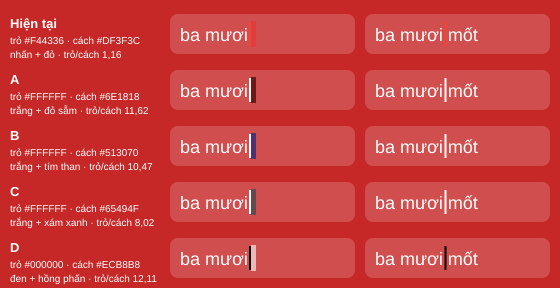

**11 · Hồng — đã chọn A** (con trỏ hồng rất nhạt `#FFDBE8`; nền dấu cách):
- A: mận sẫm `#4A0E2E` 80% → `#61183C` (9,71)
- B: tím `#311B92` 70% → `#5A2689` (7,98)
- C: xám xanh `#37474F` 70% → `#5F445A` (6,72)
- D: đen 50% → `#5E1F3A` (9,55)

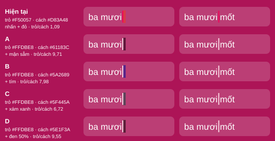

**12 · Hồng nhạt — đã chọn D** (giữ con trỏ hồng `#E36087`; nền dấu cách xám). Con trỏ hồng và nền xám khác sắc
màu nên vẫn phân biệt được dù số tương phản độ sáng thấp:
- A: xám rất nhạt `#BDBDBD` 80% → `#C9C1C4` (1,89)
- B: xám nhạt `#9E9E9E` 70% → `#BAAEB2` (1,56)
- C: xám vừa `#757575` 60% → `#AA9AA0` (1,25)
- D: xám đậm `#212121` 70% → `#62565A` (2,10)

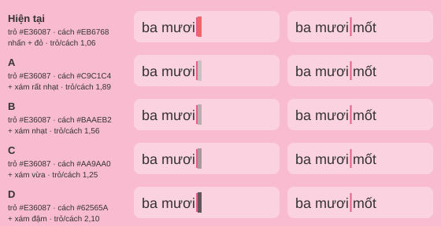

**13 · Cát — đã chọn D:** con trỏ đỏ đậm `#660003`, giữ nền dấu cách đỏ (trỏ / cách 4,39; trỏ / khung 11,33).

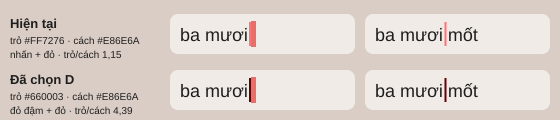

**14 · Nâu — đã chọn C:** con trỏ be nhạt `#EAE3E1`, giữ nền dấu cách đỏ (trỏ / cách 4,03; trỏ / khung 5,23).

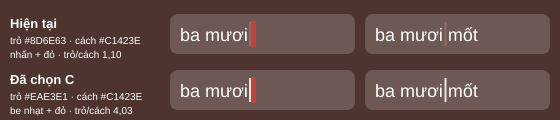

**Đợt 2 (người dùng chọn 2026-11-23, đã làm): giao diện 6, 7, 8, 10, 15.** Con trỏ hiện tại khó thấy trên nền đỏ (tương phản trỏ /
cách: 6 Xanh lá 1,18; 7 Xanh mòng két 2,13; 8 Xanh dương 1,61; 10 Tím đậm 1,40; 15 Xanh xám 1,52). Mỗi giao diện: A, B
chỉ đổi con trỏ (giữ dấu cách đỏ); C, D đổi cả nền dấu cách. Số trong ngoặc: trỏ / cách · trỏ / khung.

**6 · Xanh lá** (khung `#64B168`):
- A: đen `#000000` + giữ đỏ (4,84 · 8,03)
- B: lục rất đậm `#143816` + giữ đỏ (3,01 · 5,00)
- C: đen `#000000` + trắng 60% → lục rất nhạt `#C1E0C3` (14,72 · 8,03)
- D: lục rất đậm `#143816` + lục rất nhạt `#C1E0C3` (9,16 · 5,00)

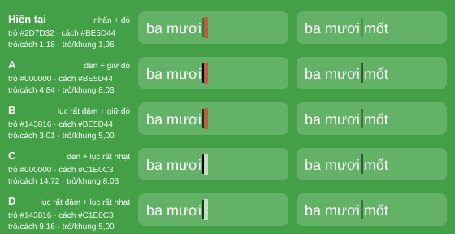

**7 · Xanh mòng két** (khung `#2E8479`):
- A: trắng `#FFFFFF` + giữ đỏ (5,19 · 4,47)
- B: mòng két rất nhạt `#DBF0EE` + giữ đỏ (4,38 · 3,77)
- C: trắng + mòng két sẫm `#004C43` 85% → `#07544B` (8,83 · 4,47)
- D: trắng + tím than `#1A237E` 70% → `#20407C` (10,07 · 4,47)

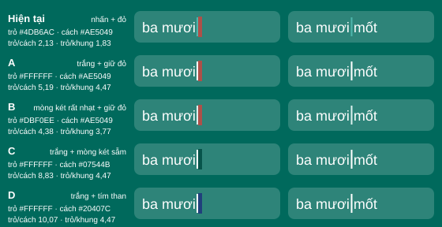

**8 · Xanh dương** (khung `#3F80CB`):
- A: trắng `#FFFFFF` + giữ đỏ (5,02 · 4,07)
- B: đen `#000000` + giữ đỏ (4,18 · 5,16)
- C: trắng + xanh sẫm `#082445` 85% → `#103259` (12,94 · 4,07)
- D: đen + trắng 60% → xanh rất nhạt `#B2CCEA` (12,72 · 5,16)

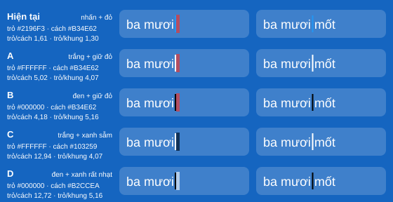

**10 · Tím đậm** (khung `#664DB1`):
- A: trắng `#FFFFFF` + giữ đỏ (5,15 · 6,44)
- B: tím rất nhạt `#E2DAF1` + giữ đỏ (3,81 · 4,76)
- C: trắng + tím sẫm `#1B0F3E` 85% → `#26184F` (15,84 · 6,44)
- D: trắng + đỏ sẫm `#5D0F0F` 85% → `#5E1827` (12,84 · 6,44)

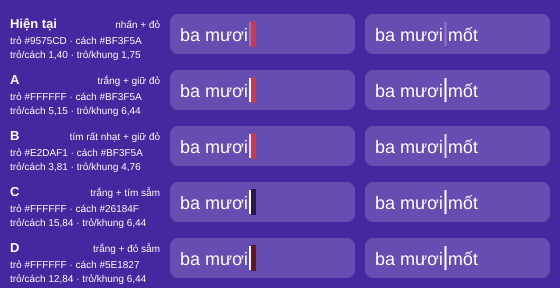

**15 · Xanh xám** (khung `#5B686E`):
- A: trắng `#FFFFFF` + giữ đỏ (5,09 · 5,75)
- B: xám xanh rất nhạt `#E2E7E9` + giữ đỏ (4,08 · 4,61)
- C: trắng + xám sẫm `#1F292D` 85% → `#283237` (13,11 · 5,75)
- D: trắng + đỏ sẫm `#5D0F0F` 85% → `#5D1C1D` (12,73 · 5,75)

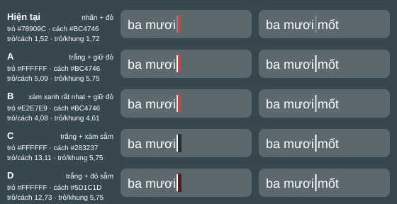

**Đợt 3 (người dùng chọn 2026-11-23, đã làm): giao diện 17, 18.** Cả hai có khung gõ `#5C5C5C`, nền bàn phím `#161616`, chữ trắng;
tương phản trỏ / cách hiện tại: 17 Holo xanh 2,22 (trỏ `#003D5C`), 18 Holo trắng 2,84 (trỏ `#282828`). Số trong ngoặc:
trỏ / cách · trỏ / khung.

**17 · Holo xanh:**
- A: trắng `#FFFFFF` + giữ đỏ (5,20 · 6,69)
- B: xanh rất nhạt `#B3E5FC` + giữ đỏ (3,84 · 4,95)
- C: xanh rất nhạt `#B3E5FC` + xanh Holo sẫm `#003D5C` 85% → `#0E425C` (7,95 · 4,95)
- D: đen `#000000` + xanh Holo `#33B5E5` 80% → `#3BA3CA` (7,28 · 3,14)

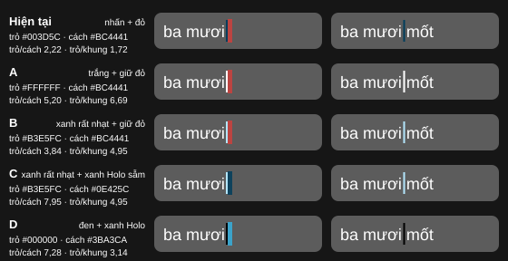

**18 · Holo trắng:**
- A: trắng `#FFFFFF` + giữ đỏ (5,20 · 6,69)
- B: đen `#000000` + giữ đỏ (4,04 · 3,14)
- C: trắng + xám sẫm `#212121` 70% → `#333333` (12,63 · 6,69)
- D: đen + trắng 60% → xám nhạt `#BEBEBE` (11,30 · 3,14)

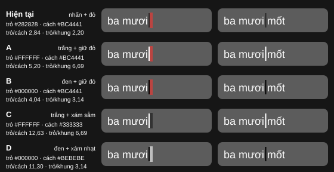

Lựa chọn của người dùng: **5A, 11A, 12D, 13D, 14C**, đợt 2: **6D, 7C, 8C, 10C, 15C**, đợt 3: **17C, 18C** (18 lúc đầu chọn A, đổi sang C cùng ngày). Trong code: `ThemeSpec.CARET` / `ThemeSpec.TRAILING` (`Theme.kt`),
khung gõ dùng `KeyboardTheme.caret` / `KeyboardTheme.trailingSpace`; các giao diện khác giữ con trỏ màu nhấn và dấu cách
đỏ `#E53935` đục 70%.

#### Màu nhấn trong bảng "Thay đổi bàn phím" (người dùng chọn 2026-11-23, đã làm)

Bảng hiện khi chạm phím ngôn ngữ / nút "Ngôn ngữ tiếp theo" (`KeyboardDialog.kt`): thẻ nền màu phím chữ, dòng đang
chọn có ✓, chữ và nền viên màu nhấn (nền viên = màu nhấn đục 19%), nút "Cài đặt ngôn ngữ" màu nhấn. Ở nhiều giao diện
"Màu", màu nhấn gần màu thẻ nên dòng đang chọn và nút chìm hẳn. Số: tương phản chữ màu nhấn với nền viên của dòng · với
thẻ (≥ 3 là thấy rõ; chữ thường nên ≥ 4,5). Ảnh: nền là bàn phím đã tối đi như lúc bảng hiện; thẻ trái là hiện tại.

Phương án đổi cả màu chữ / ✓ / nút lẫn nền viên (đổi chữ thôi thì nền viên màu nhấn nhạt vẫn làm chữ chìm). Chữ cái có
cùng nghĩa ở mọi giao diện: **A** màu nhấn đậm hơn (thẻ sáng) hoặc nhạt hơn (thẻ tối), cùng sắc; **B** màu con trỏ khung gõ
đã chọn ở trên (chỉ có khi khác màu chữ); **C** màu chữ của giao diện. Nền viên đi kèm: "nền nhấn cũ" (giữ như hiện tại),
"nền tối" (đen đục 22% phủ lên thẻ), "nền sáng" (trắng đục 40%), "nền cùng màu chữ" (màu chữ mới đục 19%). Phương án C
làm dòng đang chọn cùng màu chữ với các dòng khác, chỉ khác ở ✓ và nền viên. 6C chỉ đạt 2,61 với thẻ (chữ trắng trên lục
nhạt).

**1 · Material sáng** (thẻ `#FBFBFC`, nhấn `#5CB5AB`): chữ/dòng 2,03 · chữ/thẻ 2,35 — **không nổi bật**
- A: `#397E77` (nhấn đậm hơn · nền nhấn cũ → `#DDEEED`): 3,96 · 4,59
- C: `#061D28` (= màu chữ · nền nhấn cũ → `#DDEEED`): 14,44 · 16,73

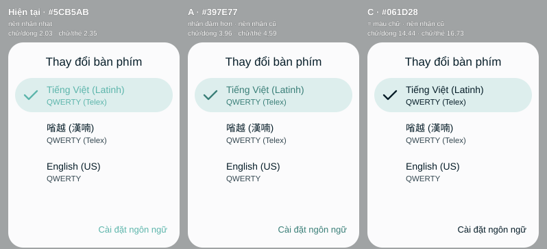

**2 · Material tối** (thẻ `#404A50`, nhấn `#6EACA8`): chữ/dòng 2,72 · chữ/thẻ 3,51 — **không nổi bật**
- A: `#91C0BD` (nhấn nhạt hơn · nền tối → `#323A3E`): 5,79 · 4,53
- C: `#FFFFFF` (= màu chữ · nền tối → `#323A3E`): 11,60 · 9,08

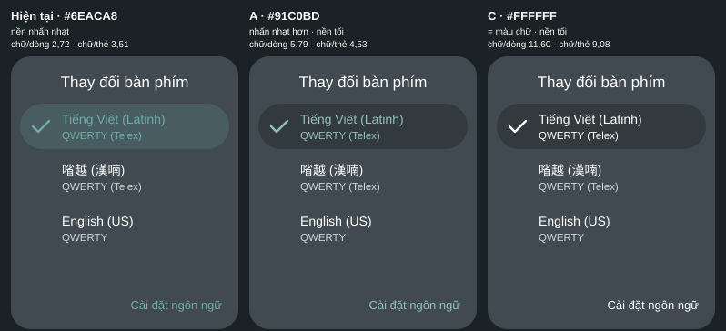

**3 · Google xanh sáng** (thẻ `#FFFFFF`, nhấn `#1A73E8`): chữ/dòng 3,52 · chữ/thẻ 4,51 — đạt, giữ nguyên

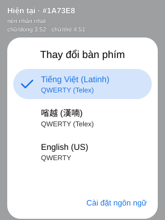

**4 · Google xanh tối** (thẻ `#484C4F`, nhấn `#5E97F6`): chữ/dòng 2,42 · chữ/thẻ 2,99 — **không nổi bật**
- A: `#9ABDF9` (nhấn nhạt hơn · nền tối → `#383B3E`): 5,91 · 4,55
- C: `#FFFFFF` (= màu chữ · nền tối → `#383B3E`): 11,27 · 8,67

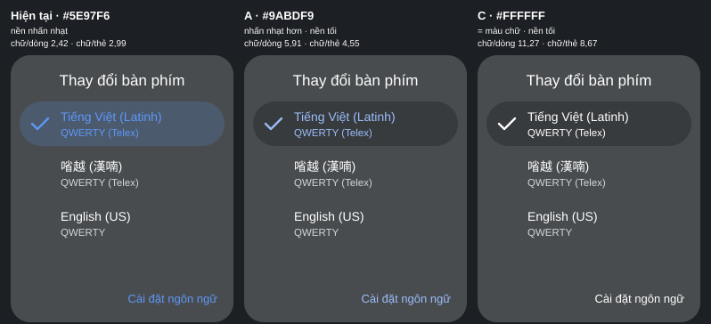

**5 · Đỏ** (thẻ `#D04E4E`, nhấn `#F44336`): chữ/dòng 1,14 · chữ/thẻ 1,17 — **không nổi bật**
- C: `#FFFFFF` (= màu chữ · nền tối → `#A23D3D`): 6,42 · 4,30

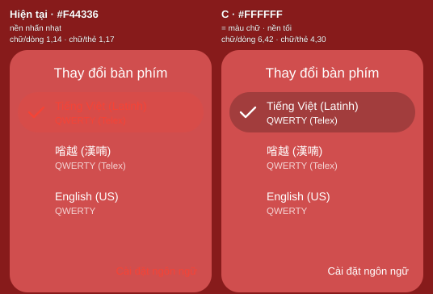

**6 · Xanh lá** (thẻ `#64B168`, nhấn `#2D7D32`): chữ/dòng 1,74 · chữ/thẻ 1,96 — **không nổi bật**
- B: `#143816` (= màu con trỏ · nền sáng → `#A2D0A4`): 7,53 · 5,00
- C: `#FFFFFF` (= màu chữ · nền tối → `#4E8A51`): 4,14 · 2,61

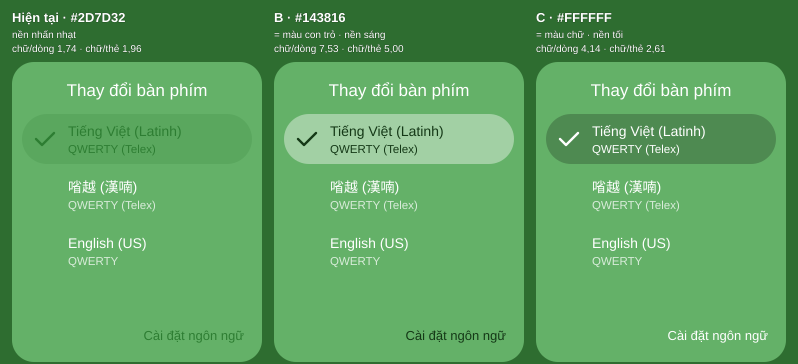

**7 · Xanh mòng két** (thẻ `#2E8479`, nhấn `#4DB6AC`): chữ/dòng 1,63 · chữ/thẻ 1,83 — **không nổi bật**
- C: `#FFFFFF` (= màu chữ · nền tối → `#24675E`): 6,61 · 4,47

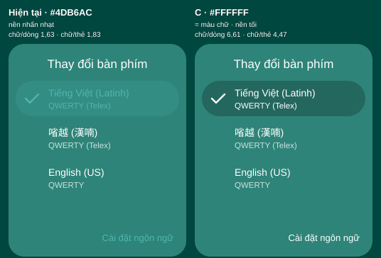

**8 · Xanh dương** (thẻ `#3F80CB`, nhấn `#2196F3`): chữ/dòng 1,24 · chữ/thẻ 1,30 — **không nổi bật**
- C: `#FFFFFF` (= màu chữ · nền tối → `#31649E`): 6,09 · 4,07

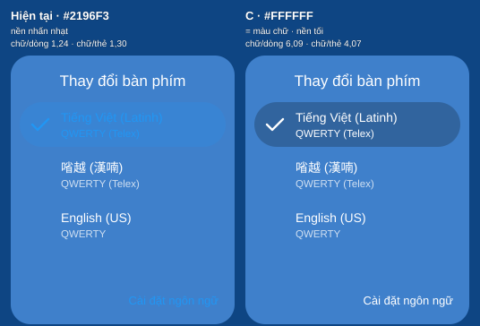

**9 · Xanh lơ** (thẻ `#ACE9F1`, nhấn `#00ACC1`): chữ/dòng 1,79 · chữ/thẻ 2,04 — **không nổi bật**
- A: `#006D7A` (nhấn đậm hơn · nền cùng màu chữ → `#8CD2DB`): 3,56 · 4,52
- C: `#333333` (= màu chữ · nền cùng màu chữ → `#95C7CD`): 6,82 · 9,43

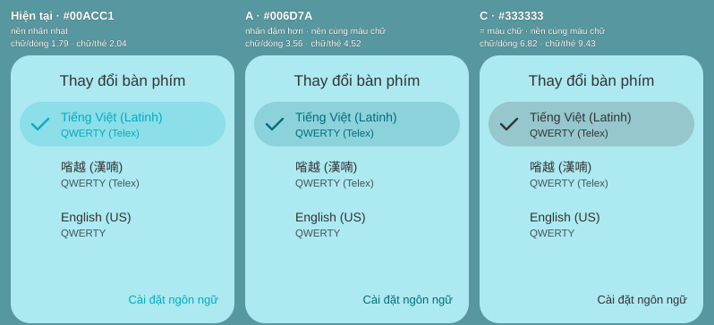

**10 · Tím đậm** (thẻ `#664DB1`, nhấn `#9575CD`): chữ/dòng 1,56 · chữ/thẻ 1,75 — **không nổi bật**
- A: `#DFD6F0` (nhấn nhạt hơn · nền tối → `#503C8A`): 6,38 · 4,60
- C: `#FFFFFF` (= màu chữ · nền tối → `#503C8A`): 8,92 · 6,44

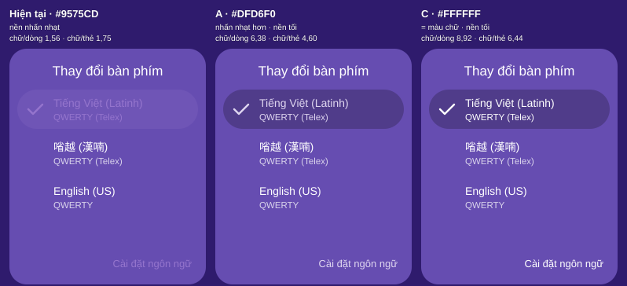

**11 · Hồng** (thẻ `#BB3E75`, nhấn `#F50057`): chữ/dòng 1,23 · chữ/thẻ 1,24 — **không nổi bật**
- A: `#FFEBF2` (nhấn nhạt hơn · nền tối → `#92305B`): 6,59 · 4,54
- B: `#FFDBE8` (= màu con trỏ · nền tối → `#92305B`): 5,92 · 4,08
- C: `#FFFFFF` (= màu chữ · nền tối → `#92305B`): 7,51 · 5,17

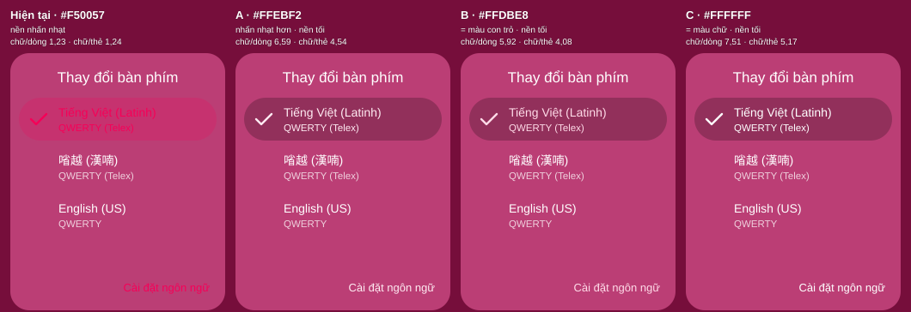

**12 · Hồng nhạt** (thẻ `#FAD2E0`, nhấn `#E36087`): chữ/dòng 2,08 · chữ/thẻ 2,44 — **không nổi bật**
- A: `#B6204D` (nhấn đậm hơn · nền nhấn cũ → `#F6BDCF`): 3,97 · 4,65
- C: `#333333` (= màu chữ · nền nhấn cũ → `#F6BDCF`): 7,88 · 9,24

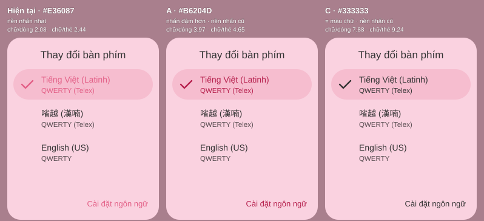

**13 · Cát** (thẻ `#F0EBE7`, nhấn `#FF7276`): chữ/dòng 1,91 · chữ/thẻ 2,24 — **không nổi bật**
- A: `#D60006` (nhấn đậm hơn · nền nhấn cũ → `#F3D4D2`): 3,93 · 4,59
- B: `#660003` (= màu con trỏ · nền nhấn cũ → `#F3D4D2`): 9,68 · 11,33
- C: `#1E1E1E` (= màu chữ · nền nhấn cũ → `#F3D4D2`): 12,03 · 14,08

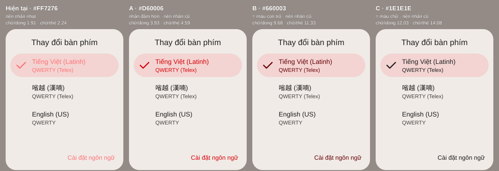

**14 · Nâu** (thẻ `#6D5853`, nhấn `#8D6E63`): chữ/dòng 1,34 · chữ/thẻ 1,43 — **không nổi bật**
- A: `#DDD3CF` (nhấn nhạt hơn · nền tối → `#554541`): 6,18 · 4,51
- B: `#EAE3E1` (= màu con trỏ · nền tối → `#554541`): 7,16 · 5,23
- C: `#FFFFFF` (= màu chữ · nền tối → `#554541`): 9,08 · 6,62

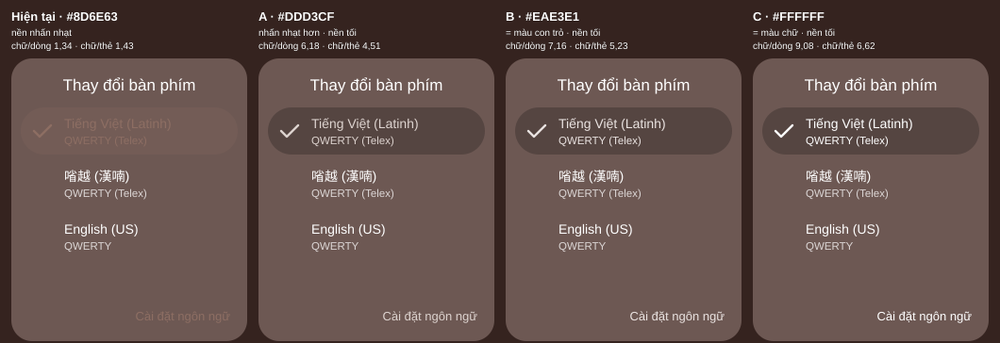

**15 · Xanh xám** (thẻ `#5B686E`, nhấn `#78909C`): chữ/dòng 1,54 · chữ/thẻ 1,72 — **không nổi bật**
- A: `#E2E7E9` (nhấn nhạt hơn · nền tối → `#475156`): 6,53 · 4,61
- C: `#FFFFFF` (= màu chữ · nền tối → `#475156`): 8,14 · 5,75

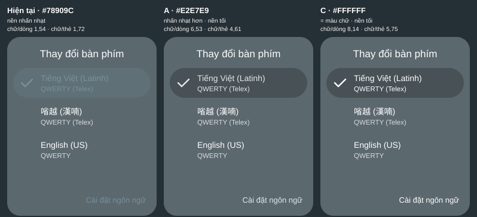

**16 · Đen** (thẻ `#2E2E2E`, nhấn `#80CBC4`): chữ/dòng 4,83 · chữ/thẻ 7,28 — đạt, giữ nguyên

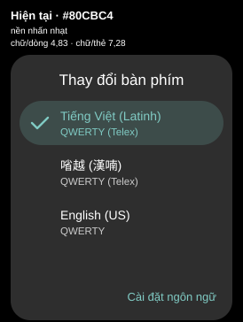

**17 · Holo xanh** (thẻ `#5C5C5C`, nhấn `#003D5C`): chữ/dòng 1,53 · chữ/thẻ 1,72 — **không nổi bật**
- A: `#99DDFF` (nhấn nhạt hơn · nền tối → `#484848`): 6,16 · 4,50
- B: `#B3E5FC` (= màu con trỏ · nền tối → `#484848`): 6,76 · 4,95
- C: `#FFFFFF` (= màu chữ · nền tối → `#484848`): 9,15 · 6,69

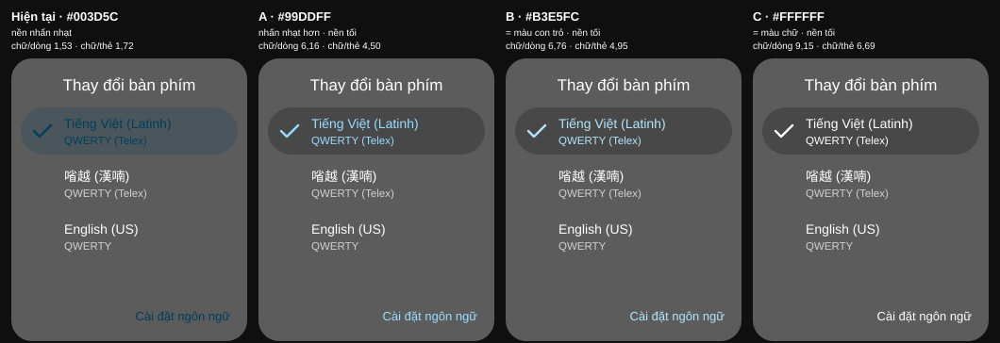

**18 · Holo trắng** (thẻ `#5C5C5C`, nhấn `#282828`): chữ/dòng 1,89 · chữ/thẻ 2,20 — **không nổi bật**
- A: `#D4D4D4` (nhấn nhạt hơn · nền nhấn cũ → `#525252`): 5,27 · 4,51
- C: `#FFFFFF` (= màu chữ · nền nhấn cũ → `#525252`): 7,81 · 6,69

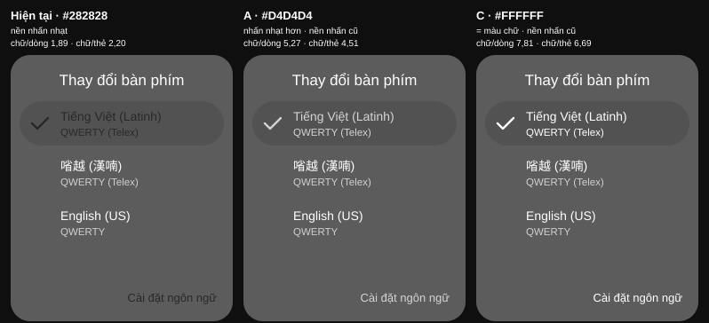

Lựa chọn của người dùng: **1A, 2A, 4A, 5C, 6C, 7C, 8C, 9A, 10A, 11A, 12A, 13A, 14A, 15A, 17A, 18A**; 3 và 16 giữ
nguyên. Trong code: `ThemeSpec.DIALOG` (`Theme.kt`) → `KeyboardTheme.dialogAccent` / `dialogRow`, dùng ở
`KeyboardDialog.kt`.

### F2. Gõ Quốc ngữ & Hán Nôm

**Flow:**

1. Người dùng chạm phím; chuỗi đang gõ hiện gạch chân trong ô nhập (composing text).
2. Lõi xử lý theo kiểu gõ đang bật (Telex đầy đủ hoặc rút gọn) và chế độ (Quốc ngữ / Hán Nôm).
3. Thanh gợi ý (F3) cập nhật; người dùng chạm gợi ý hoặc phím cách để chèn.

**Quy tắc:**

- Telex đầy đủ ở chế độ Quốc ngữ: biến đổi trực tiếp như Unikey (`vieejt` → việt).
- Telex rút gọn: gõ chữ gốc (`nom`), gợi ý hiện các dạng có dấu / chữ Hán Nôm khớp.
- Hán Nôm gõ âm đọc bằng Telex tự do như Quốc ngữ: phím cách một lần là tách chữ (khung gõ hiện dấu cách),
lần nữa mới chọn gợi ý đầu; không có gợi ý thì chốt chữ Quốc ngữ đang gõ. Quốc ngữ: phím cách chốt từ.
- Gõ tắt toàn phụ âm (Hán Nôm, Telex): nhiều phụ âm liền nhau không dấu cách thì mỗi chữ cái là một phụ âm
đơn, đúng phụ âm đó: không tự gộp sang phụ âm dài hơn (`bndtp`: n là n, không phải nh; p không phải ph) và
không gộp hai chữ cái thành phụ âm đôi (`nh` là n + h, `ch` là c + h). Riêng `q` (không tự là phụ âm đầu) là
qu; `dd` là đ. Một phụ âm đứng một mình (`n`) vẫn gợi ý mọi âm bắt đầu bằng nó.
- Ứng dụng đổi ô nhập hoặc con trỏ nhảy chỗ khác: chốt nguyên chuỗi đang gõ, không mất chữ.
- Ô nhập mật khẩu: tự chuyển chế độ Tiếng Anh, không lưu, không học.

### F3. Thanh gợi ý

- Dải nằm trên bàn phím, không cuộn; số ô và cỡ ô theo cụm chữ Hán dài nhất đang hiện:
toàn chữ đơn 6 ô, có từ kép 5 ô; 3–4 chữ 4 ô, tổng ≤ 11 chữ (4+4+2+1, 3+3+3+2); 5–6 chữ 3 ô,
tổng ≤ 11 chữ; cụm 7 chữ 3 ô (cụm 7 + một cụm ≤ 3 chữ + một chữ
đơn); 8–10 chữ 2 ô (cụm dài + một cụm ≤ 3 chữ); 11 chữ 2 ô (+ một chữ đơn); > 11 chữ chỉ mình nó.
Ít gợi ý hơn số ngăn thì không giãn ra cả thanh: các ô rộng như khi đủ ngăn, xếp từ ngăn 1 bên
trái (một chữ đơn chiếm ngăn 1 trong 6), phần còn lại để trống. Mỗi lần chỉ một cụm dài (≥ 7). Lấy gợi ý theo thứ tự xếp hạng, cái nào không vừa khuôn thì xuống
bảng mở rộng; gợi ý đầu luôn trên thanh. Ô chữ Hán rộng theo số chữ; tràn thanh thì thu nhỏ đều
chữ cho vừa, tới 15sp; vẫn tràn thì gợi ý đầu đứng một mình, thu nhỏ tiếp cho vừa; từ 21 chữ trở
đi giữ nguyên cỡ chữ như lúc 21 chữ, thanh kéo ngang được. Chữ Latin không tính vào số
chữ, chỉ rộng vừa đủ cho chữ khỏi dính; đơn, kép, Latin hiện lẫn được. Nút hỏi thêm từ vào từ điển
không tính vào số ô (5 cụm 2 chữ vẫn đủ 5 ô), chỉ chiếm thêm bề rộng. Giữa các ô có vạch ngăn mảnh,
không chạm viền trên dưới.
- **Chữ Latin** (bàn phím Hán Nôm kiểu Telex; người dùng đặt 2026-11-18): mọi chữ gõ ra đều có lựa chọn giữ nguyên chữ
Latin ở **vị trí thứ 2** (ngay sau gợi ý đầu), là chữ của âm đang được trỏ tới: chưa chốt âm thì chữ đầu (`khoong mootj hai` → thanh: 空沒𠄩 · không · …); đã chốt âm thì chữ Hán các âm đã chốt viết liền chữ Latin của chữ kế tiếp
(空một). Gõ nhiều chữ thì **cả cụm Latin** (không một hai; đã chốt: 空một hai) không lên thanh mà đứng **ô đầu của
bảng thả**. Chữ Latin luôn ở **ô 2 của thanh** (không xuống lưới). Chạm chọn ở cột trái chưa đổi chữ Latin; **chốt
âm** rồi thì chữ Latin của âm đó chỉ là **các phần đã chọn**, thay cho cả âm đã gõ: gõ `thooi`, chạm t → vẫn `thôi`;
chốt âm ở `t…` → `t` (không phải `tôi`); chốt khi đã chọn tới thanh → đúng âm đó; chốt mà chưa chọn gì → `thôi`
(người dùng đổi 2026-11-18, thay quy tắc cũ `trung` chọn ch → chung). Bật 𡨸單
cũng có chữ Latin ở vị trí thứ 2. Không còn phân biệt chữ phổ biến / chữ không phải tiếng Việt (`lag`, `alo`,
`chunom` như nhau).
- **Gợi ý quá dài** (người dùng muốn 2026-11-23): bàn phím Hán Nôm đo từng gợi ý ở cỡ chữ thật (theo "Cỡ chữ"); gợi ý
nào rộng hơn ô của nó trên thanh thì xuống bảng thả, thanh xếp lại, không cắt "…" (trước đây ô chữ Latin tính ở cỡ
100% nên cỡ to bị "…"). Bàn phím Quốc ngữ / tiếng Anh như Gboard (đo 2026-11-23, Cỡ chữ 200%): thanh 3 ô đều nhau,
mỗi từ ít nhất một ô; còn chỗ (ít từ, từ ngắn) thì từ dài giãn ra vừa chữ, không đủ chỗ cho mọi từ thì ô đều nhau.
Từ không vừa ô thì ép hẹp chữ theo chiều ngang như Gboard (cỡ chữ thường: `experiences` ép còn ~0,68 vẫn hiện đủ),
từ ngắn hơn mức dưới đây ép bao nhiêu cũng được, luôn hiện đủ; dài hơn thì ép tối đa tới 0,6, vẫn không vừa thì cắt ở
giữa giữ đầu và cuối ("ng…ng"). Mức (người dùng đặt 2026-11-23): Cỡ chữ 100% là 24 ký tự (cả Quốc ngữ lẫn tiếng Anh),
200% là 6 (Quốc ngữ) / 8 (tiếng Anh), giữa hai mốc nội suy theo đường thẳng (150%: 15 / 16; 85%: 27). Ô rộng 335 px (95,7 dp) ở mọi cỡ chữ; lề chữ 8 dp phía vạch ngăn, ô sát nút ⊞ lề trái 18 dp,
ô sát nút góc lề phải 19 dp (đo Gboard 2026-11-23). Từ vừa ô thì không bao giờ có "…".
- Nút mũi tên ở cuối dải mở **bảng mở rộng** dạng lưới, chiếm chỗ bàn phím, cuộn dọc; chỉ hiện các
gợi ý chưa có trên thanh.
- **Cột chọn nhanh** (bên trái bảng mở rộng) thu hẹp âm tiết đầu từng cấp: phụ âm đầu → nguyên âm → vần →
phụ âm cuối → thanh. Đầu cột có sẵn mục đúng âm đã gõ (gõ `tôi` thì có `tôi`); đã chốt âm thì âm kế tiếp cũng có
mục này, không vào thẳng phụ âm đầu (gõ `an chi chi`, chốt an → cột có `chi`; người dùng muốn 2026-11-23). Đã chốt
âm mà chưa chọn gì ở âm kế tiếp thì đầu cột không có mục "‹" (trước ghi "‹ chi"); bỏ chốt bằng phím xoá. Gõ liền
nhiều âm không dấu cách (kể cả chữ tiếng Anh): cột trái hỏi lần lượt từng đoạn âm của lõi (người dùng muốn 2026-11-23):
phụ âm ngay trước nguyên âm thuộc âm sau; phụ âm thừa (cuối chuỗi, hay thừa trước phụ âm đầu của âm sau) làm phụ âm cuối
của âm trước nếu ghép thành âm; phím dấu Telex chỉ gắn vào âm khi âm đó trùng đúng một chữ khung gõ hiện; phím dấu gõ đôi
để huỷ (`xx`) là một đoạn. `internet` → in · te · r · net, `ex` → ẽ, `exx` → e · x, `exchangings` → ẽ · cha · ngi · n · g
· s, `anchichi` → an · chi · chi, `chunom` → chu · nom. Chữ thô (đã huỷ dấu; lõi đặt ký tự U+E000 ở đầu) chia theo chữ
cái, ký tự thô không thuộc đoạn nào và không bao giờ hiện ra. Vần kết thúc bằng i / y không đi với ng, c (tiếng Việt viết
inh, ich): `ings` không còn thành "íng".
Mục chọn nhanh chỉ hiện khi âm đó ra chữ Hán Nôm thật (không tính lựa chọn giữ chữ Latin). Vần luôn được hỏi; vần không thể
có phụ âm cuối (vần đôi ôi, ai, âu…) thì khỏi hỏi phụ âm cuối (t → ô → ôi → thanh). Các thanh luôn xếp theo thứ tự cố định: ngang, huyền, sắc,
hỏi, ngã, nặng (ma, mà, má, mả, mã, mạ). Đã chọn một âm (kể cả mục chọn nhanh) thì cột vẫn hiện các thanh
khác của chính âm đó để đổi.
- **Chốt âm bằng phím cách mà chưa chọn gì ở cột trái** (người dùng quyết định 2026-11-22, thay luật 2026-11-17
"`tooi` chỉ là tôi"): phần đã gõ giữ đúng, phần chưa gõ để mở. Chữ cái gõ không dấu phụ nhận mọi dấu phụ (`cong`:
cong, công, cơng; d không thành đ); chưa gõ thanh thì nhận mọi thanh (`coong`: công, cống, cồng, cổng, cộng); đã gõ
thanh thì đúng thanh đó (`coongs`: cống). Âm chưa có phụ âm cuối nhận thêm phụ âm cuối (`too`: tô, tôn, tố…). Chỉ gõ
phụ âm (`c`) thì nhận mọi âm bắt đầu bằng chữ đó, gồm cả ch. Muốn đúng một âm (cả thanh ngang) thì chọn ở cột trái.
Từ điển hiện có: `cong` 55 chữ, `nhan` 93 chữ (khoảng 2–3 trang lưới).
- **Nhóm phụ âm đầu** (do người dùng đặt): có một phụ âm trong nhóm xuất hiện ở cột chọn nhanh thì hiện cả
các phụ âm cùng nhóm, nhưng tự ẩn phụ âm nào ghép vào không ra chữ nào cho gọn (gõ `cũng`: có gũng nên hiện g,
không có kũng nên ẩn k; chỉ gõ phụ âm đầu thì ẩn phụ âm không có âm nào trong từ điển); phụ âm đã gõ đứng đầu.
Các nhóm:
  - b / m / v / p / ph / d / gi / r
  - l / n
  - đ / t / th
  - c / k / qu / g / gh
  - ch / tr
  - ng / ngh
  - s / x
  - h, kh, nh đứng riêng.

  Ngoại lệ một chiều: gõ d thì cột hỏi thêm đ (vẫn ẩn nếu không ra chữ); gõ đ thì không hỏi d.

  Đổi qu sang phụ âm khác thì bỏ u, vì chỉ qu mới có u (`quá` → cá, ká, gá, ghá); đổi sang qu thì thêm u.
  Gõ `q` (chưa có u, kể cả gõ tắt `qg`) thì cột mặc định là qu, không có lựa chọn q riêng: q → qu, c, g, k, gh.

  Gõ tắt toàn phụ âm (`ndtphn`): âm tiết đầu là chữ cái đầu (n), nên cột hỏi như khi chỉ gõ `n`: n, rồi các
  phụ âm dài hơn bắt đầu bằng nó (ng, nh, ngh), rồi phụ âm cùng nhóm; chọn phụ âm nào cũng ra chữ của phụ âm đó.
  Chưa chọn gì thì thanh gợi ý và lưới có chữ một âm như khi gõ `n` (cả chữ n, ng, nh, ngh; `tphn` → cả chữ t,
  th, tr; `ph` → cả chữ p và ph). Cụm gõ tắt và câu ghép tự động vẫn giữ mỗi chữ cái là một phụ âm (`cn` không
  thành 𡨸喃 chữ nôm). Thứ tự gợi ý: cụm có sẵn trong từ điển khớp cả chuỗi, rồi chữ của âm đầu (`phn` → 拜
  phải, 發 phát…); câu ghép tự động đứng sau 3 chữ đầu. Mỗi mảnh một chữ cái của câu ghép lấy chữ dùng nhiều
  nhất (cả phụ âm dài hơn: `phn` → 拜河內 phải hà nội, không phải pi).
- **Học cụm:** đưa ra cả cụm trong một lượt gõ (chọn từng phần `tphn` → 城, 舖, 河內, hay chọn câu ghép) thì cụm
được thêm / tăng trong từ điển, gõ tắt toàn phụ âm còn nhớ cả mã (`城舖河內;tphn`): lần sau gõ `tphn` cụm đứng đầu.

  Mã: `INITIAL_GROUPS` trong `core/src/engine.rs`. Chỉ người dùng đổi nhóm, không tự thêm bớt.
- **`w` gõ một mình** là âm bắt đầu bằng ư (`w` → 央 ương, 約 ước…), cả trong gõ tắt: `tw` chọn tr ở cột,
chọn 中 thì `w` còn lại gợi ý 央 (trung ương).
- Gợi ý ghép tự động không giới hạn độ dài, kể cả cụm lặp một chữ (`nomnomnom…` → 喃喃喃…);
dài trên 11 chữ thì một mình nó trên thanh gợi ý.
- Khung gõ (pinyin) một dòng, dài quá thì ẩn phần đầu. Chuỗi phím đang gõ tối đa 80 phím, quá thì
bỏ phím và rung báo, để không treo bàn phím.
- Nhấn giữ một gợi ý: hiện âm đọc, "Xoá khỏi gợi ý" (với mục học được / từ điển riêng).
- Khi không gõ gì: thanh hiện nút nhanh – chuyển Telex đầy đủ ↔ rút gọn, mở từ điển, cài đặt,
dán từ bộ nhớ tạm.
- Chữ ngoài BMP (𡨸…) hiển thị bằng phông Nôm đóng gói trong ứng dụng; độ trễ cập nhật gợi ý
≤ 50 ms trên máy tầm trung.

### F4. Từ điển riêng (kiểu Gboard)

- Định dạng và validation giống `PRD-desktop.md` F6: mỗi dòng `chữ;âm đọc;độ phổ biến` (`喃;nôm;30`),
chữ nhiều âm thì mỗi âm một dòng, UTF-8, `#` chú thích. Học thói quen là tăng độ phổ biến ngay trong
từ điển như desktop F5; từ điển lưu khi đóng bàn phím.
- Từ điển đã lưu theo định dạng cũ (`chữ;âm1,âm2`) trong máy được đổi tên thành `dictionary-old.txt`,
bàn phím dùng từ điển mặc định mới.
- Một từ điển duy nhất như desktop F6: lần đầu là bản sao từ điển mặc định, mọi thay đổi ghi
thẳng vào đó.
- Ứng dụng cài đặt → "Từ điển": danh sách mỗi cặp chữ – âm một dòng kèm độ phổ biến, xếp a → z, có
tìm kiếm; nút `+` thêm mục gồm 3 ô "Chữ", "Âm đọc" (gõ được nhiều âm, ngăn cách bằng `,`), "Độ phổ
biến"; chạm một dòng để sửa (chữ, âm, độ phổ biến) / xoá. Quản lý, nhập (Gộp / Thay toàn bộ), tự gộp
từ điển mặc định khi cập nhật ứng dụng: như desktop F6.
- Nút "Từ điển mặc định": gộp lại mục mặc định còn thiếu, hoặc thay toàn bộ bằng từ điển mặc định.
- Nhập: chọn một hoặc nhiều tệp `.txt` từ bộ nhớ máy / Files / iCloud Drive / Google Drive; mở
hoặc chia sẻ một / nhiều tệp `.txt` vào ứng dụng (Share sheet / Intent). Các tệp được gộp tự
động vào từ điển; hiện xem trước từng tệp: số mục mới, trùng, lỗi (kèm số dòng) trước khi xác nhận.
- Xuất: tạo tệp `.txt` và mở hộp thoại chia sẻ.
- Thêm nhanh từ bàn phím: đang gõ kết thúc bằng `'`, từ đơn (`nom'`) hay cụm (`chu'nom'`), thì luôn
hỏi "Thêm … vào từ điển?" ở đầu thanh gợi ý, kể cả khi đã có gợi ý hay đã có trong từ điển (để thêm
chữ khác cùng âm đọc). Không có `'` cuối thì chỉ hỏi khi không có gợi ý và đang gõ một từ đơn
(không có `'` ở giữa) chưa có trong từ điển. Bấm vào mở ứng dụng với ô Âm đọc đã điền sẵn.
- Âm đọc điền sẵn chỉ tách âm tiết ở chỗ người dùng gõ `'` hoặc phím cách,
không tự tách: `chu'nom` → "chu nom", `chunom` → "chunom".
- Hán Nôm: Enter chèn đúng chữ Quốc ngữ đang hiện trong khung gõ; phím cách mới chọn chữ Hán.
- iOS: từ điển lưu trong App Group để keyboard extension đọc được; extension chỉ đọc, ứng dụng
chủ ghi.

### F5. Chuyển chế độ & cài đặt

- Chạm nút chế độ ở hàng dưới: xoay vòng Quốc ngữ → Hán Nôm → Tiếng Anh; nhấn giữ hiện menu
chọn trực tiếp và chọn kiểu gõ đầy đủ / rút gọn.
- Phím quả địa cầu (iOS) / chuyển bàn phím (Android) giữ hành vi chuẩn của hệ điều hành.
- Ứng dụng cài đặt có: hướng dẫn bật bàn phím từng bước (iOS: bật "Cho phép truy cập đầy đủ"
chỉ cần cho rung/âm thanh, ghi rõ không gửi dữ liệu), kiểu đặt dấu cũ/mới, số gợi ý, học
thói quen (bật/tắt, xoá dữ liệu học), giao diện, rung/âm thanh.
- Cài đặt hỏng hoặc thiếu: dùng mặc định, bàn phím vẫn hoạt động.

**Lựa chọn ưu tiên (chép từ Gboard 18.5, đo trên điện thoại 2026-11-18; chờ người dùng xem).** Nhãn tiếng Anh lấy
từ APK Gboard. Không chép (người dùng không cần): Phím biểu tượng cảm xúc, Phím chuyển đổi ngôn ngữ, Phím dấu phẩy,
Dải gợi ý, Bàn phím một tay, Thêm dấu chấm khi nhấn hai phím cách, Dấu cách tự động sau chấm câu, Tự động chuyển sau
khi nhập dấu nháy đơn, Chạm và giữ các phím để nhập ký hiệu, Vuốt phím để nhập ký hiệu, Độ nhạy đối với thao tác xoay
cổ tay, Cửa sổ bật lên của phím, Thời gian chạm và giữ, Biểu tượng ứng dụng. Phím dấu chấm (Period key) cũng bỏ:
phím chấm luôn có.

Bản cũ (0.1.9) chỉ có: Phím → Tự động viết hoa; Gõ phím → Âm thanh, Rung khi thao tác với bàn phím (chỉ bật / tắt);
Bố cục → Chiều cao bàn phím, Khoảng trống dưới bàn phím.

Đổi 2026-11-18 (người dùng muốn): bỏ cả nhóm **Bố cục** (chiều cao, khoảng trống dưới bàn phím) khỏi trang này, chỉnh
bằng nút Kích thước trên bàn phím. Bàn phím một tay nhớ riêng cỡ (chiều cao, khoảng trống dưới đáy, bề rộng) và vị
trí đã kéo; bấm phóng to thì bàn phím đầy đủ trở lại đúng cỡ và vị trí của nó.

Giới hạn kéo của Kích thước ở **màn hình ngang**, đo Gboard trên điện thoại 2026-11-22 (có hàng số, màn cao 1240 px
= 354 dp): đỉnh khung không lên quá 762 px tính từ đáy (61,5% màn hình), khung cao hay thấp cũng vậy; cỡ mặc định
(khung 762 px ≈ 218 dp) đã chạm trần nên không kéo cao hơn mặc định. Thấp nhất khung 573 px ≈ 164 dp: thanh trên giữ
nguyên, hàng phím còn 0,687 mặc định (bàn phím mình: 24 dp, đã đúng). Khoảng trống dưới đáy lớn nhất = trần trừ
khung (khung thấp nhất: 190 px ≈ 54 dp). Bàn phím mình trước cho đỉnh khung lên tới 83,5% màn hình, giờ 61,5%.
Chưa đo khi tắt hàng số.
Chiều cao từng hàng phím (px, phím / bước; khe 12 px không đổi), đo cùng ngày: mặc định hàng số 93 / 105, hàng chữ
113 / 125, phím cách 108 / 120; thấp nhất 57 / 69, 75 / 87, 69 / 81. Gboard không co các hàng cùng tỉ lệ, nên hàng số
và hàng phím cách tính theo đường thẳng qua hai cỡ này; hàng chữ mặc định 36 dp, thấp nhất 25 dp. Đo lại bàn phím mình
cỡ mặc định: 93 / 113 / 108, đỉnh bàn phím trùng Gboard (trước: 91 / 110 / 104, đỉnh thấp hơn 18 px). Kéo ✥ chạm giới
hạn dọc thì đỏ cả cạnh trên lẫn cạnh dưới.

**Màn hình dọc**, đo Gboard 2026-11-22 (px, phím; khe các hàng chữ 28 px): thấp nhất hàng số 79, hàng chữ 83 (bước
111 = 31,7 dp), phím cách 93; mặc định 126 / 133 (bước 161) / 144; cao nhất 220 / 233 (bước 261 = 74,6 dp) / 246. Khe
dưới hàng số 24 px (mình trước 28). Phím cách (cả khe) = 1,02 × hàng chữ + 7,8 px (trước 1,068 × hàng chữ). Trang
?123 và =\< giống nhau: khe giữa các hàng cố định ~58 px (phím / bước: 87 / 145 thấp nhất, 151 / 211 mặc định, 285 /
342 cao nhất); trước là phím = bước / 1,4. Hàng chữ thấp / cao nhất 32 / 75 dp (trước 36 / 72). Màn hình ngang: trang
?123 ở các giới hạn chưa đo (vẫn phím = bước / 1,3).

**Bàn phím một tay** (dọc), đo Gboard 2026-11-22 bằng cách kéo khung Kích thước (px, phím / khe; hàng số, hàng chữ, ?123):
thấp nhất (khối 220 dp) 99 / 18, 104 / 21,5, 121 / 44, phím cách 112; mặc định (khối 258 dp) 117 / 21, 124 / 24,5,
145 / 50, phím cách 134; trung gian (khung 319 dp) 155 / 21, 165 / 24, 194 / 50; cao nhất (khối 355 dp) 182 / 21,
193 / 24,5, 234 / 51, phím cách 204. Hệ số các hàng như bàn phím đầy đủ (hàng số 0,932, phím cách 1,02 × + 2,23 dp);
bước hàng chữ mặc định ~148,75 px = 42,5 dp (đầy đủ 46 dp). Kéo thấp hơn mặc định thì khe hàng, lề trên (7 → 21 px tới
phím đầu) và lề dưới (13 → 16 px) co theo; cao hơn thì chỉ phím cao thêm. Khe ?123 ≈ 2,04 khe hàng chữ. Ngang: khe
12–13 px ở mọi bề rộng, phím = khung / 10 − 13 (87%: 94, 75%: 81). Thanh trên 42 dp (từ đỉnh khối tới phím đầu 168 px).
Khung mặc định cách mép 4 dp, kéo ✥ thì sát mép được. Kéo góc = kéo hai cạnh, mỗi chiều chạm giới hạn riêng. Bàn phím
mình đo lại cùng ngày: khớp Gboard tới 1–2 px ở mặc định, thấp nhất, cao nhất và trang ?123.

**Ngôn ngữ ứng dụng** (đầu trang Ngôn ngữ, 2026-11-18): Mặc định của hệ thống (máy tiếng Việt → Tiếng Việt, khác →
English) / Tiếng Việt / Tiếng Việt (Hán Nôm) / English. Từ điển cũng gọi ngôn ngữ này là Tiếng Việt (Hán Nôm). Chữ giao diện qua `Context.tr(vi, en, nom)` (`AppText.kt`); danh sách chữ và
các chữ còn thiếu bản Hán Nôm (cột English / Tiếng Việt / Hán Nôm) cho người dùng điền ở `app-labels.md`, chuỗi chưa có chữ Hán Nôm thì hiện tiếng Việt.

Từ điển: tạo mới / đổi tên mà trùng tên từ điển khác (không phân biệt hoa thường) thì báo ngay dưới ô nhập, không lưu.

| Nhóm / mục (tiếng Anh)                          | Tiếng Việt                                                            | Hán Nôm              | Trạng thái                                                                                                                                                                              |
| ----------------------------------------------- | --------------------------------------------------------------------- | -------------------- | --------------------------------------------------------------------------------------------------------------------------------------------------------------------------------------- |
| Preferences                                     | Lựa chọn ưu tiên                                                      | 攄𫾗優先                | cũ                                                                                                                                                                                      |
| *Keys*                                          | *Phím*                                                                | 柉                    | cũ                                                                                                                                                                                      |
| Number row                                      | Hàng số                                                               | 行數                   | **mới**: tắt thì trang chữ bỏ hàng số, bàn phím thấp đi một hàng số. Chưa có: số nhỏ trên phím hàng q–p và giữ phím ra số như Gboard                                                    |
| Number row for passwords                        | Hàng số cho mật khẩu                                                  | 行數賙密口                | **mới**: chỉ bật được khi tắt Hàng số; ô mật khẩu vẫn có hàng số                                                                                                                        |
| *Theme*                                         | *Giao diện*                                                           | 交面                   | **mới**                                                                                                                                                                                 |
| Font, Nomna default                             | Phông chữ (mặc định của bàn phím / của hệ thống)                      | 風𡨸默定𧵑系統, 風𡨸默定𧵑盤柉 | **mới**: đổi phông chữ Latin trên phím và thanh gợi ý (Roboto ↔ phông hệ thống); chữ Hán Nôm giữ phông Hán Nôm                                                                          |
| Font size, Same as device                       | Cỡ chữ (85%, giống như thiết bị, 115–200%)                            | 𢤫𡨸, 𠏳如設備          | **mới**: chữ trên phím; chưa áp cho thanh gợi ý. Icon thanh công cụ to như Gboard (×1,07 / 1,14 / 1,24 / 1,44 / 1,53 ở 115–200%; nút ⊞ ít hơn, tới ×1,21; vòng nền bánh răng giữ nguyên). Icon shift / xoá / enter to theo số đo Gboard (giữ cỡ tới 150%, ở 200% shift ×1,33, xoá / enter ×1,2); nhãn rộng hơn phím thì thu cho vừa. `12/34` và `=\<` to kiểu icon (tới 150% giữ nguyên, 180% ×1,15, 200% ×1,25); `12/34` cỡ 13,7 sp ở 100%, chữ số giãn như Gboard; `=\<` thu nhỏ cho bằng Gboard (0,42 → 0,34 hàng). Chữ gợi ý Hán Nôm to theo bảng phóng chữ (Gboard 200%: ×1,63; "Giống như thiết bị" để sp tự theo hệ thống); gợi ý từ Quốc ngữ / tiếng Anh chưa đổi. Bảng thả: chữ lưới, cột trái, nút 單 theo bảng phóng chữ, ít ô hơn khi chữ to (200%: ~4 ô); mũi tên ▲▼ ×1,75, nút xoá ×1,2; cỡ gốc như Gboard (chữ lưới 22 → 19 sp, 單 18 → 20,5 sp, mũi tên ×1,17, xoá ×1,12). Phóng phi tuyến như Gboard (bảng phóng chữ của Android 14, `FontScale.kt`; đo Gboard 2026-11-22: chữ phím 24 sp ở nấc 200% lên 36 sp, `?123` 16 → 28 sp; 85% phóng thẳng) |
| Use device font size                            | Sử dụng cỡ chữ của thiết bị                                           | 使用𢤫𡨸𧵑設備           | **mới**                                                                                                                                                                                 |
| Emoji size                                      | Kích thước biểu tượng cảm xúc (7 nấc, 9 → 5 emoji một hàng)           | 戟𡱩表象感觸              | **mới**: số cột bảng emoji màn hình dọc. Nấc 8+ / 7+ giữ số cột, emoji to hơn 6% / 9,5% (đo Gboard 2026-11-18). Thiếu: màn hình ngang chưa đổi                                                             |
| Set the size and number of emoji shown in a row | Đặt kích thước và số lượng biểu tượng cảm xúc hiển thị trong một hàng | 撻戟𡱩吧數量表象感觸顯示𥪝𠬠行   | **mới**                                                                                                                                                                                 |
| Use default                                     | Dùng kích thước mặc định                                              | 用戟𡱩默定               | **mới**                                                                                                                                                                                 |
| *Layout*                                        | *Bố cục*                                                              | 佈局                   | cũ                                                                                                                                                                                      |
| Keyboard height                                 | Chiều cao bàn phím                                                    | 朝高盤柉                 | cũ, Gboard không có ở trang này (chỉnh bằng nút Kích thước)                                                                                                                             |
| Bottom gap                                      | Khoảng trống dưới bàn phím                                            | 壙𥨨𤲂盤柉              | cũ, Gboard không có                                                                                                                                                                     |
| *Key tap*                                       | *Gõ phím*                                                             | 𢱗柉                  | cũ                                                                                                                                                                                      |
| Sound                                           | Âm thanh                                                              | 音聲                   | cũ                                                                                                                                                                                      |
| Volume                                          | Âm lượng (0–100%)                                                     | 音量                   | **mới**: hộp thoại thanh kéo Mặc định / Huỷ / OK, phát thử khi kéo; mờ khi tắt Âm thanh. Chưa đo mức mặc định của Gboard (máy người dùng đang 80%): mặc định ở đây là âm lượng hệ thống |
| Keyboard vibration                              | Rung khi thao tác với bàn phím                                        | 搈朞操作唄盤柉              | cũ                                                                                                                                                                                      |
| Vibration strength on keypress                  | Cường độ rung khi nhấn phím (mặc định của hệ thống, 1–100 mili giây)  | 強度搈朞扨柉, 默定𧵑系統       | **mới**: rung thử khi kéo; mờ khi tắt Rung                                                                                                                                              |
| System default                                  | Mặc định của hệ thống                                                 | 默定𧵑系統               | **mới**                                                                                                                                                                                 |

### F6. Bảng emoji & tìm emoji

- Hàng trên bảng emoji: nút quay lại (tròn), nút tìm, các nhóm (cuộn ngang), như Gboard.
- Tìm emoji theo tên và từ khoá CLDR (tiếng Việt, tiếng Anh; gõ không dấu được). Kết quả 2 hàng, cuộn
theo trang 7 cột; giữ ô để chọn màu da / giới tính, bản chọn chỉ được gõ ra, không đổi màu chung.
- Nhãn giao diện đổi theo bàn phím đang dùng (Tiếng Việt / Hán Nôm / Tiếng Anh). Chữ Hán Nôm do người
dùng quyết định; mục còn trống chờ bổ sung, tạm hiện tiếng Việt:

| Chỗ hiện                    | Tiếng Việt                     | Hán Nôm | Tiếng Anh                      |
| --------------------------- | ------------------------------ | ------- | ------------------------------ |
| Nút tìm, chữ mờ trong ô tìm | Tìm kiếm                       | 尋檢      | Search                         |
| Tiêu đề ô tìm               | Tìm biểu tượng cảm xúc         | 尋表象感觸   | Search emoji                   |
| Tiêu đề nhóm gần đây        | Biểu tượng cảm xúc gần đây     | 表象感觸近低  | Recent emoji *(đề xuất)*       |
| Tiêu đề nhóm                | Mặt cười và biểu tượng cảm xúc | 𩈘唭表象感觸 | Smileys & emotions *(đề xuất)* |
| Tiêu đề nhóm                | Người                          | 𠊛      | People *(đề xuất)*             |
| Tiêu đề nhóm                | Động vật và thiên nhiên        | 動物吧天然   |                                |
| Tiêu đề nhóm                | Thực phẩm và đồ uống           | 食品吧𣘊㕵  | Food & drink *(đề xuất)*       |
| Tiêu đề nhóm                | Du lịch và địa danh            | 遊歷地名    | Travel & places *(đề xuất)*    |
| Tiêu đề nhóm                | Hoạt động và sự kiện           | 活動吧事件   |                                |
| Tiêu đề nhóm                | Đồ vật                         | 𣘊物     | Objects *(đề xuất)*            |
| Tiêu đề nhóm                | Biểu tượng                     | 表象      | Symbols *(đề xuất)*            |
| Tiêu đề nhóm                | Cờ                             | 旗       | Flags *(đề xuất)*              |

- Trang biểu tượng chữ `:-)`, như Gboard: cao hơn trang emoji 136 dp (màn hình dọc), hàng trên là nút quay lại, nút
"gần đây" (icon đồng hồ) rồi tên các nhóm (cuộn ngang); mỗi nhóm một trang riêng, lưới 4 cột, không có tiêu đề.
Biểu tượng lấy từ Gboard (`tools/emoji/gen_emoticons_gboard.py`, 14 nhóm × 32). Tên nhóm tiếng Việt và tiếng Anh
theo Gboard; cột Hán Nôm chờ người dùng điền, còn trống thì tạm hiện tiếng Việt:

| Nhóm biểu tượng chữ | Tiếng Việt            | Hán Nôm | Tiếng Anh           |
| ------------------- | --------------------- | ------- | ------------------- |
| Classic             | Cổ điển               | 古典      | Classic             |
| Smiling             | Cười                  | 唭       | Smiling             |
| Love                | Tình yêu              | 情𢞅     | Love                |
| Hugging             | Ôm                    | 揞       | Hugging             |
| Flexing             | Gập cánh tay          | 岋𦑃𢬣   | Flexing             |
| Animals             | Động vật              | 動物      | Animals             |
| Surprise            | Ngạc nhiên            | 愕然      | Surprise            |
| Dancing             | Nhảy múa              | 𬦮𢷵    | Dancing             |
| Shruggie            | Nhún vai              | 撋𦠘     | Shruggie            |
| Table flip          | Lật bàn               | 搮盤      | Table flip          |
| Look of disapproval | Ánh nhìn không đồng ý | 映𥆾空同意  | Look of disapproval |
| Crying              | Khóc                  | 哭       | Crying              |
| Nervous             | Lo lắng               | 𢥈𢠯    | Nervous             |
| Pointers            | Con trỏ               | 𡥵𢸫    | Pointers            |

- Tên từng emoji (tiếng Việt, tiếng Anh theo CLDR, cột Hán Nôm tạm sinh tự động — **chưa thống nhất**):
[emoji-names.md](emoji-names.md).
- Gõ chữ Hán Nôm vào ô tìm: mỗi chữ được đổi ra mọi âm đọc của nó trong từ điển đang dùng (cả chữ người dùng tự
thêm), emoji khớp khi tên hay từ khoá có một chữ trùng một âm đọc đó (𩈘唭 tìm như "mặt cười"). Không dùng cột Hán
Nôm của emoji-names.md.

## 3. Yêu cầu phi chức năng

- Hiệu năng: bàn phím hiện lên ≤ 300 ms; mỗi phím ≤ 16 ms (không giật khung hình).
- Bộ nhớ: keyboard extension iOS ≤ 48 MB (giới hạn của hệ thống) – từ điển dùng định dạng
nhị phân ánh xạ bộ nhớ (mmap), không nạp toàn bộ vào RAM.
- Riêng tư: không yêu cầu quyền mạng; không gửi dữ liệu gõ; dữ liệu học chỉ lưu trên máy.
- Trợ năng: phím có nhãn cho TalkBack / VoiceOver; hỗ trợ cỡ chữ lớn trong ứng dụng cài đặt.
- Kiểm thử: unit test `core/` dùng chung; test UI bàn phím bằng Espresso (Android) và XCUITest
(iOS); kiểm thử thủ công trên Zalo, Messenger, Notes, Chrome/Safari.
- Phát hành: Google Play và App Store; ảnh, tên, biểu tượng là của dự án, không dùng thương hiệu
Google/Gboard.

## 4. Danh sách chức năng & trạng thái

| STT | Chức năng               | Mã  | Phụ thuộc    | Trạng thái                          |
| --- | ----------------------- | --- | ------------ | ----------------------------------- |
| 1   | Bindings `core/` (JNI)  | C1  | core desktop | \[x\] Xong                          |
| 2   | Bố cục bàn phím         | F1  | –            | \[\~\] Android                      |
| 3   | Gõ Quốc ngữ & Hán Nôm   | F2  | C1, F1       | \[\~\] Android                      |
| 4   | Thanh gợi ý             | F3  | F2           | \[\~\] Android                      |
| 5   | Từ điển riêng           | F4  | C1           | \[\~\] Android                      |
| 6   | Chuyển chế độ & cài đặt | F5  | F2           | \[\~\] Android                      |
| 7   | Bảng emoji & tìm emoji  | F6  | F1           | \[\~\] Android (thiếu nhãn Hán Nôm) |
| 8   | Bản Android             | A1  | F1–F6        | \[\~\] Chạy được trên máy ảo        |
| 9   | Bản iOS                 | I1  | F1–F6        | \[ \] Chưa làm                      |

## 5. Nhật ký hiệu năng

### 5.1 Cách đo

- **Cụm test kinh điển** (từ 2026-11-16): bàn phím Hán Nôm kiểu Telex, đếm "không một hai … hai mươi chín ba mươi"
(0 → 30; 15, 25 là "lăm", 21 là "mốt"): 60 âm, 341 phím. Thao tác đo: gõ từng phím, xoá từng phím, mở cột trái của
bảng thả, chọn âm (phím cách trong bảng thả), xoá âm (bỏ chốt), chọn chữ Hán, xoá chữ (gỡ chữ đã chọn).
- **Lõi trên máy tính:** `core/examples/hist.rs` (gõ, xoá, cột trái, nạp từ điển; chỉ dùng hàm có từ bản đầu),
`core/examples/cover.rs` (gợi ý đầu ở cuối cụm phủ bao nhiêu phím), `core/examples/classic.rs` (chọn âm, xoá âm,
chọn chữ, xoá chữ; chỉ có từ bản ad9d10c). Chạy WebAssembly (Node), mỗi phiên bản build riêng, đo lại cùng lúc
ngày 2026-11-16. Sai số giữa hai lần chạy khoảng ±10%: thay đổi dưới 10% coi như **ngang**.
- **Trên điện thoại**: nhật ký `HanNomPerf` (logcat). Điện thoại chậm hơn máy tính khoảng 2–3 lần.
- Phần trăm: **nhanh hơn X%** = (trước − sau) / trước; **chậm hơn X%** = (sau − trước) / trước. Mốc so là phiên bản
liền trước.

### 5.2 Lõi qua các phiên bản (máy tính, cụm 0 → 30)

Thời gian trung bình mỗi lần (ms); trong ngoặc là lần chậm nhất.

| Phiên bản (ngày)              | Nội dung chính                          | Gõ phím    | Xoá phím   | Cột trái  | Nạp từ điển | Gợi ý đầu phủ             |
| ----------------------------- | --------------------------------------- | ---------- | ---------- | --------- | ----------- | ------------------------- |
| ccd5b1a (10-30)               | Bản đầu                                 | 5,34 (15)  | 5,16 (17)  | 10,3 (26) | 161         | 7/341 phím (1 chữ)        |
| 7c04db4 (11-01)               | Một tay, xoá lùi Telex                  | 6,67 (22)  | 6,41 (19)  | 14,1 (35) | 194         | 7/341                     |
| ae4d70e (11-09)               | Tìm từ điển theo âm, bảng thả           | 6,45 (19)  | 5,98 (16)  | 13,2 (28) | 178         | 7/341                     |
| 81f6dcd (11-10)               | Màn hình ngang (0.1.3)                  | 6,34 (18)  | 6,03 (16)  | 11,6 (24) | 253         | 7/341                     |
| aa029d6 (11-10)               | Trang biểu tượng (0.1.5)                | 8,08 (45)  | 8,04 (33)  | 12,8 (25) | 211         | 7/341                     |
| a55f5e5 (11-14)               | Cột chọn nhanh theo nhóm phụ âm (0.1.6) | 8,07 (21)  | 9,18 (31)  | 5,34 (11) | 212         | 7/341                     |
| cdb199e (11-14)               | Câu ghép gõ tắt                         | 7,14 (22)  | 6,55 (19)  | 5,04 (12) | 157         | 7/341                     |
| ad9d10c (11-15)               | Chốt âm ở cột trái                      | 6,72 (16)  | 6,30 (18)  | 4,37 (10) | 122         | 7/341                     |
| Hiện tại (11-16, chưa commit) | Ghép câu không giới hạn độ dài          | 23,9 (111) | 19,5 (130) | 4,67 (12) | 112         | **341/341 phím (60 chữ)** |

So với phiên bản liền trước:

| Phiên bản | Gõ phím                             | Xoá phím             | Cột trái             | Nạp từ điển          | Đánh giá                                    |
| --------- | ----------------------------------- | -------------------- | -------------------- | -------------------- | ------------------------------------------- |
| 7c04db4   | chậm hơn 25%                        | chậm hơn 24%         | chậm hơn 37%         | chậm hơn 20%         | **Đi lùi**                                  |
| ae4d70e   | ngang (nhanh hơn 3%)                | ngang (nhanh hơn 7%) | ngang (nhanh hơn 6%) | nhanh hơn 8%         | Ngang                                       |
| 81f6dcd   | ngang                               | ngang                | nhanh hơn 12%        | chậm hơn 42%         | Đi lùi (nạp từ điển)                        |
| aa029d6   | chậm hơn 27% (chậm nhất 18 → 45 ms) | chậm hơn 33%         | chậm hơn 10%         | nhanh hơn 17%        | **Đi lùi**                                  |
| a55f5e5   | ngang                               | chậm hơn 14%         | **nhanh hơn 58%**    | ngang                | **Đột phá** (cột trái)                      |
| cdb199e   | nhanh hơn 12%                       | nhanh hơn 29%        | ngang (nhanh hơn 6%) | nhanh hơn 26%        | Cải thiện                                   |
| ad9d10c   | ngang (nhanh hơn 6%)                | ngang (nhanh hơn 4%) | nhanh hơn 13%        | nhanh hơn 22%        | Cải thiện                                   |
| Hiện tại  | chậm hơn 256% (×3,6)                | chậm hơn 210% (×3,1) | ngang (chậm hơn 7%)  | ngang (nhanh hơn 8%) | **Đột phá về chất lượng, đi lùi về tốc độ** |

Ghi chú:

- Mọi bản tới ad9d10c chỉ ghép câu cho chuỗi phím ngắn (80 phím, Telex 120): với cụm 0 → 30, gợi ý đầu chỉ là chữ
"không" (7/341 phím). Bản hiện tại ghép cả câu dài bao nhiêu cũng được (gợi ý đầu là đủ 60 chữ). Gõ, xoá chậm hơn ×3
là cái giá của việc này, nhưng vẫn chưa đạt được: chuỗi càng dài càng chậm (phím 324: 111 ms). Đây là việc cần sửa
(5.5, bước 2).
- 81f6dcd, aa029d6: từ điển to thêm nên nạp chậm hơn; cdb199e, ad9d10c đọc từ điển nhanh hơn.

### 5.3 Bảng thả: chọn âm, xoá âm, chọn chữ, xoá chữ (máy tính, cụm 0 → 30)

Có từ bản ad9d10c. Tổng thời gian cả cụm (ms); trong ngoặc là lần chậm nhất.

| Thao tác                 | ad9d10c (11-15) | Hiện tại (11-16) | Thay đổi          | Đánh giá    |
| ------------------------ | --------------- | ---------------- | ----------------- | ----------- |
| Chọn âm (60 lần ấn cách) | 1973            | 1517 (60)        | nhanh hơn 23%     | Cải thiện   |
| Xoá âm (bỏ chốt 60 âm)   | 2186            | 1014 (\~26)      | **nhanh hơn 54%** | **Đột phá** |
| Chọn chữ (59 lần)        | 1103 (60)       | 1115 (53)        | ngang             | Ngang       |
| Xoá chữ (59 lần)         | 1093 (57)       | 1090 (48)        | ngang             | Ngang       |

### 5.4 Trên điện thoại

Các lần đo ghi lại trong lúc làm (đã ghi trong mã nguồn):

| Ngày       | Thao tác                                          | Trước                                  | Sau                                                                       | Thay đổi                              | Cách sửa                                                               |
| ---------- | ------------------------------------------------- | -------------------------------------- | ------------------------------------------------------------------------- | ------------------------------------- | ---------------------------------------------------------------------- |
| 2026-11-15 | Chốt âm thứ 10 (cột trái; âm 1: 99 ms)            | \~400 ms                               | chưa đo lại trên điện thoại (máy tính: chọn âm cả cụm nhanh hơn 23%, 5.3) | —                                     | Nhớ kết quả từng đoạn âm đã chốt                                       |
| 2026-11-15 | Gõ phím, chuỗi \~1000 phím (lõi)                  | \~150 ms/phím (điện thoại)             | \~10–25 ms (máy tính; chưa đo lại trên điện thoại)                        | **Đột phá** (khác máy đo, chưa ra %)  | Ghép câu theo cửa sổ, tính tiếp từ lần trước                           |
| 2026-11-15 | Dựng khung gõ, chuỗi \~1000 phím (giao diện)      | \~100 ms/phím                          | 5,6 ms trung bình (đo 11-16, chuỗi ngắn hơn)                              | **Đột phá** (chưa đo lại ở 1000 phím) | Nhớ chữ Quốc ngữ đã hiện của từng chữ                                  |
| 2026-11-15 | Bảng thả nhận gợi ý mới                           | \~85 ms mỗi lần                        | \~0 ms                                                                    | nhanh hơn \~100%                      | Không dựng lại khi chuỗi phím không đổi                                |
| 2026-11-15 | Ấn cách / xoá trong bảng thả (giao diện phải chờ) | 40–265 ms                              | không chờ (tính ở luồng nền)                                              | giao diện hết khựng                   | Bảng gọi lõi ở luồng nền                                               |
| 2026-11-15 | Chọn 空 khi đã chốt 17 âm                          | khựng \~100 ms (chờ tra gợi ý \~45 ms) | chưa đo lại                                                               | —                                     | Tính trước cột trái; tra gợi ý sau khi dựng giao diện                  |
| 2026-11-16 | Thanh gợi ý khi chọn âm rồi xoá                   | chớp (đổi 2–3 lần)                     | đổi 1 lần                                                                 | hết chớp                              | Không hiện lại đủ gợi ý khi lưới đang thu hẹp; không dựng bảng hai lần |

Đo bằng nhật ký `HanNomPerf` ngày 2026-11-16 (01:04–01:22, gõ thường trên Messenger):

| Việc                                                  | Luồng     | Số lần | Trung bình | Chậm nhất | Số lần > 50 ms |
| ----------------------------------------------------- | --------- | ------ | ---------- | --------- | -------------- |
| Dựng khung gõ và thanh gợi ý mỗi phím                 | giao diện | 2337   | 5,6 ms     | 56 ms     | 1              |
| Tách âm (chỉ chuỗi phím chưa gặp; đã gặp thì lấy lại) | giao diện | 645    | 3,9 ms     | 49 ms     | 0              |
| Vẽ bảng thả                                           | giao diện | 416    | 9,7 ms     | 58 ms     | 1              |
| Tra gợi ý khi gõ                                      | nền       | 374    | 38 ms      | 174 ms    | 108            |
| Tính bảng thả (chọn / xoá âm)                         | nền       | 503    | 32 ms      | 392 ms    | 106            |
| Tính cột trái                                         | nền       | 2692   | 8 ms       | 228 ms    | 90             |

Luồng giao diện đã đạt (phím không khựng). Chỗ chậm là tính gợi ý ở luồng nền: gợi ý hiện trễ.

### 5.5 Kế hoạch cải thiện (2026-11-16)

Làm từng bước; mỗi bước người dùng thử và duyệt (giữ / bỏ) rồi mới làm bước sau.

| Bước | Việc                                                          | Mục tiêu                                                   | Trạng thái                                                                                                                                                                                                                                                                                                                                                                                                                                                                                                                                                                                                                                                                                                                                                                                                                                                                                                                                                                                                                                                                                                                                                                                                                                                                                                                                                                                                                                                                                                                                                                                                                                                                                                                                                                                                                                                                                                                                                                                                                                                                                                                                                                                                                                                                                                                                               |
| ---- | ------------------------------------------------------------- | ---------------------------------------------------------- | -------------------------------------------------------------------------------------------------------------------------------------------------------------------------------------------------------------------------------------------------------------------------------------------------------------------------------------------------------------------------------------------------------------------------------------------------------------------------------------------------------------------------------------------------------------------------------------------------------------------------------------------------------------------------------------------------------------------------------------------------------------------------------------------------------------------------------------------------------------------------------------------------------------------------------------------------------------------------------------------------------------------------------------------------------------------------------------------------------------------------------------------------------------------------------------------------------------------------------------------------------------------------------------------------------------------------------------------------------------------------------------------------------------------------------------------------------------------------------------------------------------------------------------------------------------------------------------------------------------------------------------------------------------------------------------------------------------------------------------------------------------------------------------------------------------------------------------------------------------------------------------------------------------------------------------------------------------------------------------------------------------------------------------------------------------------------------------------------------------------------------------------------------------------------------------------------------------------------------------------------------------------------------------------------------------------------------------------------------- |
| 1    | Xoá phím lấy lại gợi ý đã tra lúc gõ (nhớ 400 trạng thái)     | Xoá phím \~120 ms → \~0 ms                                 | **Đã duyệt 2026-11-16.** Điện thoại: lấy lại 0,0 ms thay cho tra mới 6–14 ms (chậm nhất 60 ms); người dùng thấy không rõ rệt (cụm thử ngắn), không đổi quy tắc gõ                                                                                                                                                                                                                                                                                                                                                                                                                                                                                                                                                                                                                                                                                                                                                                                                                                                                                                                                                                                                                                                                                                                                                                                                                                                                                                                                                                                                                                                                                                                                                                                                                                                                                                                                                                                                                                                                                                                                                                                                                                                                                                                                                                                        |
| 4    | Tách âm một lần mỗi phím                                      | Bớt \~10 ms giao diện mỗi phím                             | **Bỏ:** đã có sẵn (tách âm nhớ theo chuỗi phím); đề xuất ban đầu đọc nhầm nhật ký                                                                                                                                                                                                                                                                                                                                                                                                                                                                                                                                                                                                                                                                                                                                                                                                                                                                                                                                                                                                                                                                                                                                                                                                                                                                                                                                                                                                                                                                                                                                                                                                                                                                                                                                                                                                                                                                                                                                                                                                                                                                                                                                                                                                                                                                        |
| 2    | Gõ phím không chậm dần theo độ dài chuỗi                      | \~20–30 ms mỗi phím ở mọi độ dài                           | **Đã duyệt 2026-11-16** (người dùng: gõ chữ đen và xoá chữ đen "đúng là đột phá"; chọn âm / chọn chữ / xoá âm / xoá chữ vẫn lag — bước 3). Máy tính, cụm 0 → 30: gõ phím trung bình 23,9 → 7,9 ms (nhanh hơn 67%), chậm nhất 111 → 15 ms (nhanh hơn 86%); xoá phím 19,5 → 7,2 ms (nhanh hơn 63%), chậm nhất 130 → 14 ms (nhanh hơn 89%). Gợi ý giống hệt bản trước (so 20 gợi ý đầu ở 723 phím, 4 câu: `core/examples/samecand.rs`). Điện thoại (01:47–01:54, người dùng gõ tự do, chuỗi tới 267 phím; so với 01:04–01:22 trước bước 1–2, khác nội dung gõ): tra gợi ý khi gõ trung bình 38 → 29 ms (nhanh hơn 24%), chậm nhất 174 → 77 ms (nhanh hơn 56%), số lần > 50 ms 29% → 8%; khoảng 27% lần cần gợi ý lấy lại từ bộ nhớ của bước 1 (0 ms; ước theo 768 lần hỏi, 559 lần tra mới). Chưa phẳng: chuỗi 100–199 phím vẫn \~40 ms trung bình (chữ không phải tiếng Việt / gõ tắt như `lamswz`, `moofsfst` không dùng được cách cắt cửa sổ)                                                                                                                                                                                                                                                                                                                                                                                                                                                                                                                                                                                                                                                                                                                                                                                                                                                                                                                                                                                                                                                                                                                                                                                                                                                                                                                                                                                                            |
| 3    | Bảng thả: nhớ các âm đã chốt; âm nhiều chữ chỉ tính trang đầu | Chọn âm không tăng dần; chậm nhất < 100 ms trên điện thoại | **Tạm duyệt 2026-11-16** (người dùng: không ai chọn cụm 54 âm). Điện thoại, so lần thử 3a (02:09–02:12) với lần thử 3b (02:25–), khác nội dung gõ: tính bảng trung bình 58,8 → 23,9 ms (nhanh hơn 59%), chậm nhất 402 → 105 ms (nhanh hơn 74%), số lần > 50 ms 52% → 7%; tính cột trái 40,4 → 20,7 ms (nhanh hơn 49%); chữ đơn theo âm (mỗi 4 nhóm) 124 → 64 ms (nhanh hơn 48%). Còn lại: chọn âm tiến lên \~20–25 ms mỗi âm trên máy tính khi đã chốt \~40 âm (câu phủ phần phím còn lại tính lại mỗi lần). Chi tiết: **3a:** nhật ký điện thoại cho thấy chỗ lag chính là chờ, không phải tính: xoá âm khi đã chốt \~40 âm, bảng tự tính 2–8 ms mà chờ tới 402 ms sau các lần "tính trước" (33–128 ms mỗi lần) đang giữ lõi. Sửa: chỉ tính trước khi người dùng dừng tay 300 ms. Người dùng: "nhanh rõ rệt", nhưng bật 𡨸單 (chữ đơn) phải chờ lâu: điện thoại 1,1–1,5 giây khi đã chốt \~40 âm (tra lõi riêng cho từng âm, \~30 ms mỗi âm, đợi hết mới hiện). Sửa tiếp: tính 4 nhóm đầu rồi hiện ngay, các nhóm sau tính dần ở nền mỗi lần 4 nhóm, bỏ dở khi người dùng thao tác. **Tạm duyệt 2026-11-16** ("ổn hơn trước"), nhưng giữ phím xoá "siêu lag" và ấn nhanh ▲▼ cũng lag. Nhật ký: giữ xoá khi bật 𡨸單, phím lặp \~50 ms mà mỗi lần dựng lưới 10–150 ms, lưới luôn đuổi theo sau. Sửa (3a-2, chờ duyệt): thao tác dồn dập (hai lần dựng cách < 120 ms) thì khung gõ đổi ngay, lưới chỉ dựng lại trạng thái cuối khi dừng tay; ▲▼ tính từ trang đích của lần ấn trước, chỉ dựng đủ hàng cho trang đó. Người dùng **không chấp nhận** cách sửa ▲▼ (đã hoàn lại); chọn / xoá âm với nhiều âm vẫn "siêu lag". **3b (chờ duyệt):** đo trong lõi khi đã chốt 40 âm (máy tính \~36 ms mỗi lần): 30 ms là ghép câu cho các âm đã chốt — (1) tách đoạn thử mọi độ dài cụm cho mỗi âm (\~800 lần, mỗi lần dựng khoá nhớ): thêm phép tra nhanh chữ cái đầu, không có cụm thì bỏ qua; (2) câu phủ phần phím còn lại tính lại mỗi lần chốt / bỏ chốt: nhớ 96 kết quả gợi ý gần nhất theo chuỗi phím. Máy tính, cụm 0 → 30, so ngay sau nhau với bản trước: chọn âm cả cụm nhanh hơn 22% (âm 54: 53 → 30 ms), xoá âm nhanh hơn 55% (mỗi âm 13–35 → 6–13 ms), chọn chữ nhanh hơn 22%, xoá chữ nhanh hơn 26%. Kết quả giống hệt (cột trái, gợi ý khi chốt / bỏ chốt / chọn phụ âm đầu trên 3 câu: `core/examples/samelock.rs`; gợi ý khi gõ: `samecand.rs`). |

Sửa lỗi phát hiện khi so với Gboard (5.6): chạm vào lưới lúc lưới đang chờ dựng lại thì bỏ qua (trước đó chọn trúng
chữ cũ, nuốt sai phím).

### 5.6 So với Gboard 拼音 (2026-11-16)

**Cách thử.** Điện thoại Android 16, Gboard 18.5.6, ô "Gõ thử" của ứng dụng. Chạm tự động qua adb
(`input tap`, mỗi lần ~0,09–0,1 giây khi chạm dồn dập), quay màn hình bằng trình ghi màn hình của máy (bật hiện điểm
chạm). Cùng nội dung đếm 0 → 30: Gboard gõ pinyin liền (153 phím, 61 âm), bàn phím Hán Nôm gõ Telex (341 phím, 60 âm).
Số lần chạm được nhận: bàn phím Hán Nôm đếm theo nhật ký `HanNomPerf`; Gboard đếm theo ảnh chụp trước / sau mỗi đợt.
Video quay màn hình 8 phút 45 giây. Máy quay không đều (37–55 khung/giây,
có chỗ hở tới 85 ms) nên độ trễ đo trên video chỉ là ước lượng.

| Thao tác                                        | Gboard 拼音                                                                                       | Hán Nôm                                                                                                                                    | Bên tốt hơn                              |
| ----------------------------------------------- | ----------------------------------------------------------------------------------------------- | ------------------------------------------------------------------------------------------------------------------------------------------ | ---------------------------------------- |
| Gõ cả chuỗi 0 → 30                              | Câu ghép sai nhiều chữ: 另一二三四五六七**八就是**十一十二**时**三十… (lần sau, đã học: …**把就是试一试而是**三十四**食物是**…) | Câu ghép đủ 60 chữ đúng âm (空𠬠𠄩𠀧𦊚…)                                                                                                    | Hán Nôm (chất lượng)                     |
| Độ trễ khung gõ khi gõ nhanh (video, ước lượng) | Trung vị \~50 ms, 90% \~140 ms; chỉ \~33 lần vẽ lại cho 153 phím (gộp nhiều phím một lần vẽ)    | Trung vị \~17 ms, 90% \~100 ms, chậm nhất \~130 ms; vẽ lại gần như mỗi phím                                                                | Hán Nôm (đo được trên một phần lần chạm) |
| Chốt âm dồn dập (\~0,1 giây một lần)            | **1/10** lần chạm được nhận                                                                     | 9/10, rồi 50/60 (mất 17%)                                                                                                                  | Hán Nôm                                  |
| Chốt âm nhịp \~0,3 giây                         | 7/20                                                                                            | —                                                                                                                                          |                                          |
| Chốt âm nhịp \~1 giây                           | Nhận đủ; mỗi lần chốt \~0,9 giây mới thấy (video, ước lượng)                                    | Mỗi lần tính bảng \~0,2 giây khi đã chốt 40–60 âm (nhật ký)                                                                                | Hán Nôm                                  |
| Chốt hết âm                                     | Tự đưa cả câu vào ô ngay khi chốt âm cuối                                                       | Chờ chọn chữ (phím chốt âm mờ đi)                                                                                                          | Tuỳ ý người dùng                         |
| Bỏ chốt / xoá dồn dập                           | Giữ xoá 4 giây vẫn chưa xoá hết đoạn pinyin 153 phím                                            | Bỏ chốt 60 âm trong 8,7 giây, nhận đủ 60/60, về 0 ngay sau lần cuối                                                                        | Hán Nôm                                  |
| Chọn chữ dồn dập                                | Lần chạm không kịp thì **bỏ qua**, không hỏng gì                                                | **Lỗi:** lưới đang chờ dựng lại vẫn nhận chạm, chọn trúng chữ cũ (空空 + `ai'…`, nuốt sai phím). Đã sửa: bỏ qua chạm khi lưới chưa dựng xong | Gboard (trước khi sửa)                   |

**Gboard làm tốt hơn ở đâu (suy ra từ video và ảnh chụp, chưa đọc mã của Gboard):**

1. **Không bao giờ áp thao tác lên kết quả cũ.** Đang bận thì bỏ qua lần chạm, thay vì xếp hàng hay chạm vào lưới cũ.
 Bỏ qua thì người dùng phải chạm lại, nhưng không bao giờ ra chữ sai.
2. **Gộp nhiều lần vẽ khung gõ khi gõ nhanh** (\~1 lần vẽ cho 4–5 phím): bớt việc mỗi phím, phím không bao giờ khựng.
3. **Chốt âm không tính lại cả lưới.** Lưới vẫn hiện chữ của âm đầu (另令灵…) trong suốt lúc chốt các âm sau; chỉ cột trái
 (lựa chọn của âm kế tiếp) đổi. Việc mỗi lần chốt rất nhẹ.
4. **Chốt xong âm cuối thì đưa cả câu vào ô**: bớt một bước khi người dùng chỉ muốn sửa vài âm rồi lấy cả câu.

**Đề xuất cho các bản sau** (theo thứ tự lợi / công sức; mục 4 thay đổi cách dùng nên phải hỏi người dùng trước):

1. **Chốt âm nhận đủ mọi lần chạm** (hiện mất \~17% khi chạm 0,1 giây một lần): danh sách âm đã chốt chỉ là một dãy, cộng
 thêm ngay khi chạm; phần tính lại để sau (đã có hoãn dựng lưới khi thao tác dồn dập). Tìm chỗ đang bỏ lần chạm
 (`whenReady` / `canLock` khi bảng đang tính).
2. **Chốt âm chỉ tính cột trái**, như Gboard: lưới chữ của các âm đã chốt tính khi dừng tay (giảm \~0,2 giây mỗi lần
 chốt khi đã chốt 40–60 âm).
3. **Gộp vẽ khung gõ theo nhịp khung hình** (`Choreographer`) khi phím tới dồn dập.
4. (Hỏi người dùng) Có tự đưa cả câu vào ô khi đã chốt hết âm như Gboard không.
5. Giữ lợi thế hiện có: câu ghép dài đúng, xoá / bỏ chốt nhận đủ mọi lần chạm.

**Đã làm đề xuất 1 (2026-11-16, tạm duyệt, bản 0.1.8).** Đo lại thì không mất lần chạm nào: nhật ký ghi đủ 60 lần chạm xuống,
nhưng mỗi lần chốt phải chờ một lần dựng bảng (~0,2 giây), nên 60 lần chạm trong 3,5 giây xong 2 giây sau mới chốt hết
(lần đo trước đếm 50/60 khi hàng đợi chưa chạy hết). Sửa: phím chốt âm nhận lúc chạm xuống và chốt ngay, không chờ lần
dựng đang tra dở; bảng chỉ dựng lại khi dừng tay. Điện thoại: 60 lần chạm trong 3,5 giây chốt đủ 60/60, bảng chỉ tính 2
lần, xong **0,13 giây** sau lần chạm cuối (trước: ~2 giây). Chọn chữ dồn dập ở 𡨸單 sau khi sửa lỗi lưới cũ: chọn đúng
từng âm (空 → 𠬠 → 𠄩 → 𠀧), lần chạm lúc lưới chưa dựng xong bị bỏ qua như Gboard (30 lần chạm dồn dập nhận 4).

**Sửa thanh gợi ý nháy (2026-11-16, tạm duyệt, bản 0.1.8).** Mở / đóng bảng thả, chốt / bỏ chốt âm: thanh gợi ý vẽ hai
lần (đủ gợi ý, rồi bỏ các chữ của lưới), gợi ý dài và ngắn đổi chỗ liên tục. Sửa: bảng mở thì chỉ lưới vẽ thanh, một
lần khi dựng xong; gợi ý xuống lưới tính theo cách xếp thanh cho đủ gợi ý, không theo thanh đang hiện.

**Sửa mất lựa chọn chữ Latin (2026-11-16, thay APK của bản 0.1.8).** Gõ `lag`: lõi ghép được câu 痞咦 (la + g gõ tắt) phủ
hết phím, nên chữ Latin "lag" bị coi như đã có chữ Hán khớp trọn và xuống lưới. Sửa: chữ có đoạn toàn phụ âm đứng sau
một âm có nguyên âm (`lag` hiện la g) là chữ không phải tiếng Việt, chữ Latin lên thanh (vị trí 2); có nhiều chữ thì cả
cụm Latin (`không lag`) đứng trước chữ đầu (`không`). Gõ tắt dính liền âm gõ đủ (`twcmieenf`) và gõ liền (`chunom`) không
đổi. Đã chốt âm thì lựa chọn 空lag vẫn lên thanh khi thu bảng (bảng mở thì nằm ở lưới, như trước).

**Xoá trong bảng thả nhận lúc chạm, như chốt âm (2026-11-17, chờ duyệt).** Người dùng báo "mở bảng thả ra lại xoá chậm".
Đo cụm 0 → 30 trên điện thoại bằng chạm adb (bản đang sửa, chưa commit; gõ 341 phím, mở bảng, chốt 60 âm, bỏ chốt 60
âm, xoá phím): gõ, mở bảng, chốt âm đều ổn; bỏ chốt / xoá thì mỗi lần chạm phải chờ một lần dựng bảng (chờ 120 ms xem
còn chạm tiếp không, rồi tính lưới ~87 ms), chạm nhanh hơn nhịp đó thì xếp hàng, thả tay rồi vẫn xoá tiếp vài giây. Lõi
không phải nguyên nhân (máy tính: bỏ chốt 60 âm 691 → 705 ms, ngang). Sửa: nút xoá của bảng bỏ chốt / xoá phím ngay, lưới
dựng lại một lần khi dừng tay (đang lùi bước chọn ở cột trái thì vẫn chờ như cũ). Điện thoại, 60 lần chạm trong ~3,7 giây:

| Thao tác                                | Trước                                                | Sau                 | Thay đổi          |
| --------------------------------------- | ---------------------------------------------------- | ------------------- | ----------------- |
| Bỏ chốt 60 âm: xong sau lần chạm cuối   | 4,01 giây, còn 10 âm chưa bỏ                         | 0,17 giây, đủ 60/60 | **nhanh hơn 96%** |
| Bỏ chốt 60 âm: số lần tính / vẽ lưới    | 47 / 47                                              | 2 / 2               | nhanh hơn 96%     |
| Xoá 341 phím trong bảng: số lần vẽ lưới | 88 (đợt 320 lần chạm, còn \~65 phím chưa xoá khi đo) | 1 (xoá hết)         | **Đột phá**       |
| Chốt 60 âm (không đổi)                  | 0,13 giây                                            | 0,17 giây           | ngang             |

Máy ảo: bỏ chốt 60 âm 4,08 → 0,18 giây; quay màn hình lúc bỏ chốt thấy thanh gợi ý chỉ đổi 2 lần, không lần nào quay
lại trạng thái cũ (không chớp). Máy ảo có lần báo "không phản hồi" lúc xoá: luồng vẽ kẹt trong trình đồ hoạ của máy ảo
(`qemu_pipe_read`), bản trước cũng có khung hình treo 4,95 giây như vậy, không do bàn phím.

Người dùng thử: giữ xoá lúc đã chốt âm "hơi nhanh quá" (không còn bị bảng kìm, giữ xoá nhanh dần tới 20 ms một âm). Sửa:
giữ xoá khi lần xoá kế tiếp là cả một âm đã chốt / chữ đã chọn thì đều 0,2 giây một lần (nhịp cũ), không nhanh dần; hết
âm chốt thì xoá phím nhanh dần như bàn phím. Máy ảo, giữ xoá 3 giây khi đã chốt 60 âm: bỏ chốt 13 âm, cách nhau ~0,22 giây.

Cùng đợt (2026-11-17, chờ duyệt):

- **Khung kính hiện sớm khi xoá lùi.** Phần bị "…" che ngắn (ít hơn 5 lần xoá) thì khung kính chỉ hiện khi chỗ xoá đã
vào phần bị che, không kịp thấy đếm ngược. Sửa: còn "…" mà chỉ còn ≤ 5 lần xoá nữa là hết chữ chọn / âm chốt thì khung
kính hiện từ lần đó (ở chữ chọn / âm chốt sau cùng), đếm 5, 4, 3, 2, 1. Máy ảo, 15 âm (2 âm bị che): hiện từ số 5.
  - Thêm 2026-11-19 (người dùng): xoá lùi chỉ hiện khung kính khi gần tới chữ đầu tiên; xa hơn thì không hiện (trước đó
    hiện cả số 20, 60…); tới chữ đầu tiên (0) thì không có số. Mốc **12** (đếm 12 … 1, thay cho 5) cho mọi trường hợp: chữ
    Hán đã chọn, âm đã chốt, chữ đen gõ thường (xoá ký tự thường, chưa chọn / chốt gì, phần đầu bị "…" che: trước đó khung
    kính ẩn) và chữ dài không có dấu cách để tách (gõ loạn `tttt…`, quá 13 ký tự). Chữ dài không dấu cách thì khung kính
    hiện đúng 13 ký tự quanh chỗ đổi, phần còn lại là "…" (trước đó khung dài quá màn hình, tràn ra ngoài); chữ thường vẫn
    hiện 2 chữ.
- **Chữ Latin cho chữ gõ liền không có trong từ điển** (`alo`). Chỉ có câu lõi tự ghép (音嚧 = a + lo) phủ hết phím nên
chữ Latin nằm trong lưới. Sửa: chữ gõ liền nhiều âm, âm nào cũng có nguyên âm, mà không mục từ điển nào khớp trọn (câu
tự ghép không tính) là chữ không phải tiếng Việt: chữ Latin lên thanh (vị trí 2), như `lag`. Gõ tắt (có đoạn toàn phụ
âm) không đổi. Hệ quả: `chunom` (không dấu) chỉ có câu tự ghép 眾掩 nên giờ cũng có chữ Latin "chunom" ở vị trí 2.
Người dùng chọn giữ, rồi đặt luôn quy tắc chung (mục F3 "Chữ Latin"): mọi chữ có chữ Latin ở vị trí thứ 2, cả cụm Latin
ở ô đầu bảng thả, chọn ở cột trái thì theo lựa chọn, 𡨸單 cũng có. Máy ảo: `khoong mootj hai` → thanh 空沒𠄩 · không,
ô đầu bảng thả "không một hai", chốt không → 空một; `trung` chọn ch → chung (ô 2), bật 𡨸單 → 眾 · chung.
- **Trang từ điển:** (1) bỏ trống ô khi thêm / sửa mục thì báo "Chưa nhập chữ" / "Chưa nhập âm đọc" (trước: "thiếu âm
đọc sau dấu ;", nói theo định dạng tệp); (2) dòng phụ dưới tiêu đề xuống dòng khi không đủ chỗ (trước: "A → Z" bị cắt ở
mép nút tìm / thêm trên điện thoại); (3) bật / tắt từ điển tiếng Anh "siêu lag": mỗi lần gạt đếm lại số mục mọi từ điển,
đọc lại cả tệp tiếng Anh (121.813 mục) trên luồng giao diện, **1,43 giây** trên máy ảo. Sửa: nhớ số mục theo tệp (không
đổi thì không đếm lại, bật / tắt không đổi tệp), đếm lần đầu ở luồng nền ("Đang đếm số mục…" rồi hiện số).
(4) mở từ điển tiếng Anh "siêu lag" (2026-11-18): trên luồng giao diện, đọc + tách tệp **1.437 ms** (mỗi dòng tách
bằng regex, chuẩn hoá NFC), xếp a → z **797 ms** (mỗi lần so sánh bỏ dấu lại cả hai từ bằng regex + NFD); trang hiện
sau 2,96 giây; mỗi chữ gõ vào ô tìm cũng xếp lại. Sửa: dòng đã đúng dạng thì không tách regex / chuẩn hoá lại; khoá bỏ
dấu tính một lần mỗi mục, xếp một lần, giữ đến khi sửa từ điển; chữ ASCII bỏ dấu chỉ là chữ thường. Máy ảo: đọc 219 ms,
xếp 53 ms, tổng **2.234 → 272 ms (nhanh hơn 88%)**, trang hiện sau 1,05 giây (trang nào cũng mất ~0,6 giây để hiện
trên máy ảo); ô tìm 5–16 ms mỗi chữ. Từ điển tiếng Việt cũng nhờ: 121 ms.
- **Phím đầu tiên lag sau khi bàn phím khởi động** (cài bản mới, hay Android tắt bàn phím rồi bật lại; người dùng báo
2026-11-18). Nhật ký điện thoại: nạp từ điển chặn luồng giao diện ~0,66 giây (đọc 31 ms, nạp vào lõi 270 ms, tách số gốc
/ phần đã học `rebase` **362 ms**, bước mới của đợt "học không làm mòn số gốc"). Các lần mở bàn phím sau, phím đầu
16–18 ms như phím thường. Sửa: (1) `rebase` đọc thẳng từng dòng từ điển đóng gói, không dựng từ điển thứ hai (máy tính:
150 → 100 ms, `core/examples/rebasetime.rs`, kết quả giống hệt); (2) chạy ở luồng nền ngay sau khi nạp, vì nó không đổi
độ phổ biến dùng để xếp gợi ý (chỉ cần cho lúc chia đôi phần đã học); riêng lần gộp từ điển sau khi cài bản mới (lưu tệp
ngay sau đó, một lần mỗi lần cài) vẫn làm ngay. Máy ảo: luồng giao diện chỉ còn đọc + nạp (~180–220 ms), `rebase` ở nền
190–290 ms. Gõ ngay trong lúc `rebase` đang chạy thì phím đó chờ phần còn lại. Điện thoại (01:28, ngay sau khi cài):
luồng giao diện nạp từ điển ~663 → ~318 ms (**nhanh hơn 52%**: đọc 31 + nạp 287 ms); `rebase` ở nền 238 ms, xong 1,4 giây
trước phím đầu; phím đầu (`onChar`) 46 ms, không phải chờ.

**Bản 0.1.9 (2026-11-18, bản thử, release `v0.1.9-test`).** Gồm mọi sửa đổi ở trên từ 2026-11-17 (xoá trong bảng thả
nhận lúc chạm, khung kính, chữ Latin ở vị trí 2, trang từ điển, khởi động) và đợt giao diện theo số đo Gboard trên điện
thoại (2026-11-18):

- Màn hình dọc: hàng phím mức "Vừa" 46 dp (trước 50; các mức 40 / 46 / 52), thanh gợi ý / công cụ 46 dp (trước 48), khe
giữa các hàng 8 dp; hàng số thấp hơn hàng chữ (0,932) và hàng phím cách cao hơn (1,068) như màn hình ngang; bàn phím số
khe 6 dp, phím cao hơn; emoji hàng cao 1,15 × bề rộng ô, cỡ emoji 0,755 × ô. Cỡ chữ trên phím giữ như cũ.
- Thanh công cụ: icon ⊞ 28 dp, nút tròn góc phải 34 dp với icon 20 dp; các icon vẽ lại theo Gboard.
- Bảng sửa văn bản che cả thanh công cụ, đầu bảng có nút ← về bàn phím và tên bảng (như bảng nhớ tạm).
- Bảng tiện ích: thêm nút "Ngôn ngữ tiếp theo" (đổi bàn phím như chạm V / EN / 喃); nút ✎ là viên viền mảnh với bút chì
nét viền như Gboard.
- Trang từ điển: màn hình ngang chừa tai thỏ và thanh điều hướng (nền thanh tiêu đề tràn qua); hộp thoại thêm / sửa nằm
trên bàn phím, không nháy khi bàn phím đang mở; trang danh sách ngôn ngữ bỏ giữ để chọn và mục xoá.

**Bản 0.1.10 (2026-11-19, bản thử, release `v0.1.10-test`).** Gồm:

- **Ngôn ngữ ứng dụng** (đầu trang Ngôn ngữ): Mặc định của hệ thống / Tiếng Việt / Tiếng Việt (Hán Nôm) / English; chữ
  Hán Nôm do người dùng điền ở `app-labels.md` (bản Hán Nôm: tiếng Việt 㗂越, tiếng Anh 㗂英, không có dấu cách giữa số và
  chữ; nút OK là 同意). Bản tiếng Anh: tên bàn phím "Bàn phím Hán Nôm", "Vietnamese (Han Nom)", chữ theo Gboard
  (Corrections & suggestions, Keyboard languages & layouts, Play when tapping keys, Default Dark).
- **Gợi ý** (người dùng muốn 2026-11-19): thanh gợi ý xếp theo độ phổ biến, không ưu tiên cụm dài (中 dùng nhiều hơn thì
  đứng trước 中國); chỉ câu tự ghép giữ ô 1, chữ Latin vẫn ở ô 2. Lõi gửi kèm độ phổ biến của từng gợi ý (JNI thêm một
  trường). Đã chọn cả âm ở cột trái (`trung`): lưới có thêm mọi từ chứa âm đó ở bất kỳ vị trí nào (忠厚, 集中, 人中…), xếp
  chung với chữ đơn theo độ phổ biến; chạm từ thì cả từ thay cho âm đó. Chưa chọn âm thì vẫn có mọi thanh.
  Chọn âm ở cột trái (kể cả mục chọn nhanh "tôi" ở đầu cột) là đã chọn thanh; chốt âm bằng phím cách thì chưa (mọi
  thanh). Đã chọn tới âm có thanh thì thanh gợi ý phía trên là các chữ đầu của đúng âm đó theo độ phổ biến, lưới nối
  tiếp phần còn lại, không lặp (như 𡨸單); không còn chữ khác thanh (gõ tôi, chọn tôi: trước thanh còn 最 tối, 罪 tội;
  người dùng muốn 2026-11-22). Chọn dở (chưa tới thanh) thì thanh vẫn bỏ các chữ lưới đang giữ như cũ. Đã chốt âm
  thì lưới cũng theo độ phổ biến (cụm lẫn chữ đơn), không còn cụm dài trước (cùng ngày); các giới hạn cũ của lưới (mỗi
  độ dài vài cụm, không cụm tự ghép, không quá dài) giữ nguyên. Âm đầu chốt với cả âm chọn ở cột trái (tôi) vẫn có các
  từ chứa âm đó ở bất kỳ chỗ nào (眾𫇈 chúng tôi), kể cả khi gõ tiếp âm sau; chạm thì thay đúng phần phím của âm đó.
  Âm nào chưa chốt được thanh thì nhãn có đuôi "…":
  chốt bằng phím cách mà chưa chọn thanh ở cột trái (gõ `tooi`) hiện "tôi…"; gõ có thanh (`toois` → "tối") hay chọn
  âm ở cột trái thì không (cùng ngày).
- Thanh kéo Cỡ chữ / Kích thước emoji: bong bóng giá trị hiện thật (vẽ trên lớp phủ cửa sổ, trước đó không hiện), cỡ như
  Gboard (tròn 32 dp, viên "100%" ≈ 59 dp, nút kéo ngắn lại 38 dp khi giữ); vùng emoji cao cố định 64 dp, đổi nấc không
  làm trang co giãn.
- Giao diện tối mặc định theo Material 3 của Gboard: nền #1E1F20, phím chữ #37393B, phím chức năng #444746, chữ #E3E3E3,
  màu nhấn #A8C7FA (chữ trên phím nhấn #062E6F).
- Bàn phím một tay (dọc): bề ngang 75–86,7% màn hình, khối cao 220,3–354,9 dp, đỉnh khối không quá 354,9 dp từ đáy
  (trước 224–358 dp, đo theo khung của Gboard vốn thò xuống dưới khối ~13 px); kéo khung lên trên bàn phím thì phủ đen
  80% như Gboard. Cỡ phím một tay theo Gboard (đoạn "Bàn phím một tay" ở trên); cỡ một tay lưu số lẻ (dp).
- Màn hình ngang: khung chỉnh kích thước lùi khỏi tai thỏ như các phím.
- Khung kính: mốc 12 lần xoá, chuỗi dài không dấu cách hiện 13 ký tự (mục ở trên); dòng phụ trang từ điển không tách
  "A → Z" sang hai dòng.
- **Cột chọn nhanh** (người dùng duyệt 2026-11-19, APK của release thay lại 2026-11-22): mọi âm, kể cả các âm sau trong
  câu (`cong hoa nhan dan trung hoa`), hỏi đủ các cấp phụ âm đầu → nguyên âm → vần → phụ âm cuối → thanh như âm đầu.
  Bỏ quy tắc 2026-11-15 "gõ đủ âm thì chỉ hỏi phụ âm đầu rồi ra thẳng cả âm" (`nhan` không hỏi a / ă / â). Phụ âm đầu
  luôn hỏi, kể cả chỉ có một (nh, h, kh, đ…); âm không có phụ âm đầu thì khỏi. Âm sau gõ đủ chỉ giữ các âm khớp phần đã
  gõ (khác thanh, dấu mũ / móc, phụ âm cùng nhóm): chọn tr cho `trung` không còn lẫn tra, tre…; ở cấp thanh, âm của phụ
  âm đã gõ đứng trước (trung… rồi chung…).

Chưa đo: thời gian lõi quét từ điển tìm từ chứa âm đã chọn (~36.600 mục mỗi lần dựng lưới); bài thử lag kinh điển chưa
chạy lại sau đợt này.

Còn chậm (chưa sửa): tra gợi ý khi gõ ở luồng nền trên điện thoại trung bình 43 ms, 39% số lần > 50 ms (gợi ý hiện trễ,
phím không khựng); mở bảng tra cột trái 107–129 ms.